# Lab 01: Your lab machine and first containers

**Goal:** Install Docker, run your first containers, and look at a container from the host and in Portainer.

**Lecture:** L2 and L3

**Start:** a new lab machine.

## Part 1: Prepare the machine

1. Update the package lists.

   ```bash
   sudo apt-get update
   ```

2. Install the tools that the labs use.

   ```bash
   sudo apt-get -o DPkg::Lock::Timeout=300 install -y ca-certificates curl git jq
   ```

   <!-- test
   command -v curl git jq >/dev/null
   -->

3. Clone the course repository to `~/containerization-fundamentals`.

   <!-- catchup: skip -->
   ```bash
   git clone https://github.com/nicklotz/containerization-fundamentals.git \
     ~/containerization-fundamentals
   ```

   <!-- test
   test -d ~/containerization-fundamentals/app/bag-api
   -->

4. Check that VS Code is installed.

   <!-- skip -->
   ```bash
   code --version
   ```

   The first line is the version of VS Code.

5. If the command `code` was not found, install VS Code.

   <!-- skip -->
   ```bash
   sudo snap install code --classic
   ```

## Part 2: Install Docker Engine

1. Save the keyring of Docker's apt repository.

   ```bash
   sudo install -m 0755 -d /etc/apt/keyrings
   sudo curl -fsSL https://download.docker.com/linux/ubuntu/gpg -o /etc/apt/keyrings/docker.asc
   ```

2. Add Docker's apt repository.

   ```bash
   echo "deb [arch=$(dpkg --print-architecture) signed-by=/etc/apt/keyrings/docker.asc]" \
     "https://download.docker.com/linux/ubuntu $(. /etc/os-release && echo $VERSION_CODENAME) stable" \
     | sudo tee /etc/apt/sources.list.d/docker.list
   ```

   The output is one `deb` line that ends with `noble stable`.

3. Update the package lists again.

   ```bash
   sudo apt-get update
   ```

   One of the lines names `download.docker.com`.

4. Install Docker Engine with the Buildx and Compose plugins.

   ```bash
   sudo apt-get -o DPkg::Lock::Timeout=300 install -y \
     docker-ce docker-ce-cli containerd.io docker-buildx-plugin docker-compose-plugin
   ```

   <!-- test
   systemctl is-active docker
   -->

5. Add your user to the `docker` group.

   ```bash
   sudo usermod -aG docker $USER
   ```

6. Start a new shell with the `docker` group in this terminal.

   ```bash
   newgrp docker
   ```

7. Show the versions of the Docker client and server.

   ```bash
   docker version
   ```

   The output has a `Client` part and a `Server` part.

   <!-- test
   docker info >/dev/null
   getent group docker | t_contains "$USER"
   -->

8. Run a test container (`--rm` removes it when it exits).

   ```bash
   docker run --rm public.ecr.aws/docker/library/hello-world
   ```

   The output includes `Hello from Docker`.

## Part 3: First containers

1. Start nginx in a container named `web` (`-d` runs it in the background, and `-p 8090:80` publishes port 80 of the container on port 8090 of the host).

   ```bash
   docker run -d --name web -p 8090:80 public.ecr.aws/docker/library/nginx:1.29
   ```

   <!-- test
   t_running web
   t_get http://localhost:8090 >/dev/null
   -->

2. Request the start page from the host.

   ```bash
   curl -s localhost:8090 | head -4
   ```

   The fourth line holds the title `Welcome to nginx`.

3. Open http://localhost:8090 in the browser.

   <!-- shots:begin -->
   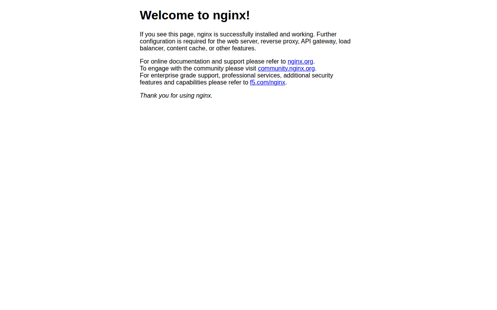

   <!-- shots:end -->

   <!-- ui: browser_open http://localhost:8090 -->

4. List the running containers.

   ```bash
   docker ps
   ```

   The `PORTS` column of `web` shows `0.0.0.0:8090->80/tcp`.

5. Show the log of `web`.

   ```bash
   docker logs web
   ```

   Each request is one line, such as `"GET / HTTP/1.1" 200`.

6. Stop the container.

   ```bash
   docker stop web
   ```

7. List all containers, including the stopped ones.

   ```bash
   docker ps -a
   ```

   The status of `web` starts with `Exited`.

   <!-- test
   t_eq "$(docker inspect -f '{{.State.Running}}' web)" false "web is stopped"
   -->

8. Start the same container again.

   ```bash
   docker start web
   ```

   <!-- test
   t_running web
   t_get http://localhost:8090 >/dev/null
   -->

## Part 4: Portainer

1. Create a volume for the data of Portainer.

   ```bash
   docker volume create portainer_data
   ```

2. Start Portainer (`--restart always` brings it back after a reboot, and the `docker.sock` mount lets it control Docker).

   ```bash
   docker run -d --name portainer --restart always -p 9000:9000 \
     -v /var/run/docker.sock:/var/run/docker.sock \
     -v portainer_data:/data \
     portainer/portainer-ce:2.45.3
   ```

   <!-- test
   for i in $(seq 1 30); do docker logs portainer 2>&1 | grep -q setup_token && break; sleep 2; done
   docker logs portainer 2>&1 | grep -q setup_token
   -->

3. Print the setup token from the log of Portainer.

   ```bash
   docker logs portainer 2>&1 | grep setup_token
   ```

   Copy the text after `setup_token=`.

4. Open http://localhost:9000 in the browser.

   <!-- shots:begin -->
   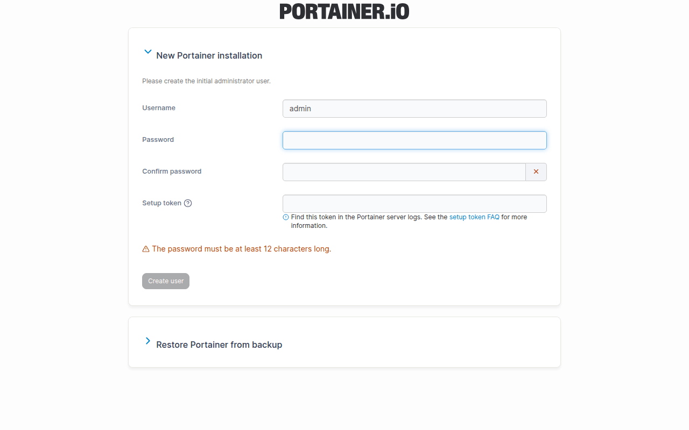

   <!-- shots:end -->

   <!-- ui: browser_open http://localhost:9000 -->

5. Paste the token into the form, enter the user name `admin` and the password `Portainer-Lab-2026` twice, and click **Create user**, then **Skip**, then **Get Started**, then **local**.

   <!-- shots:begin -->
   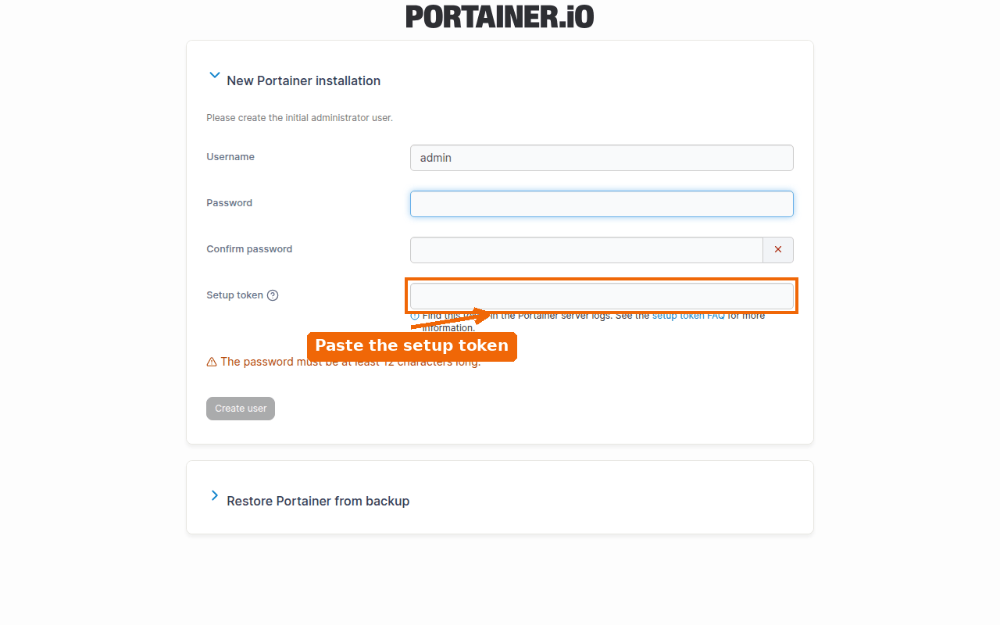

   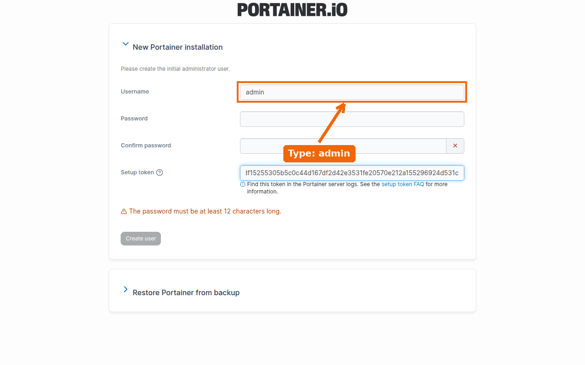

   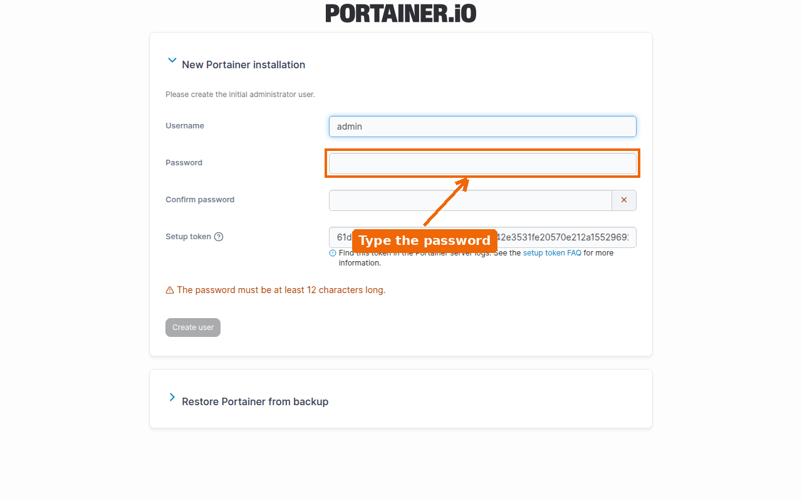

   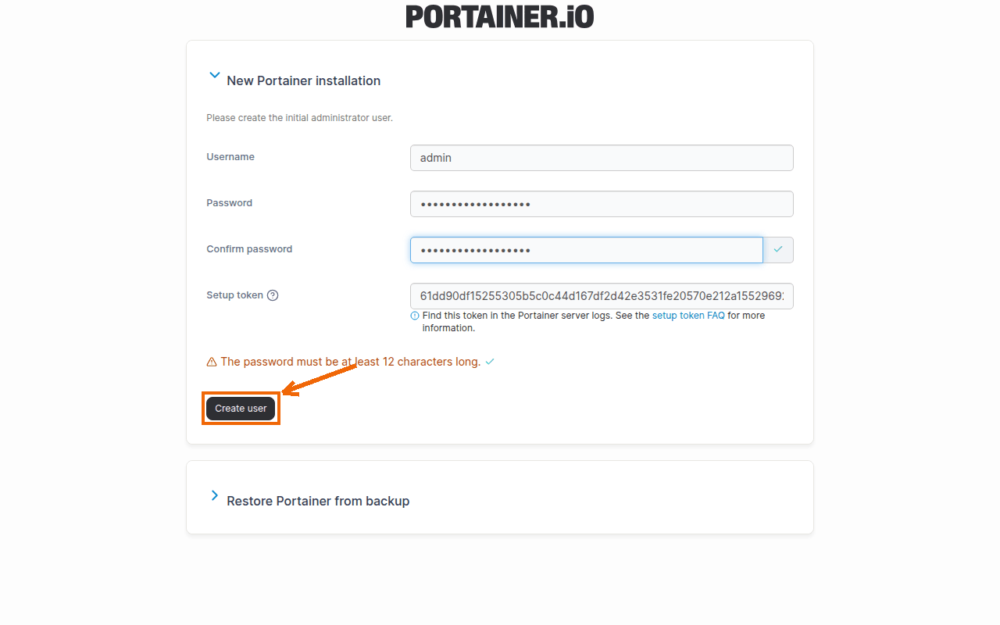

   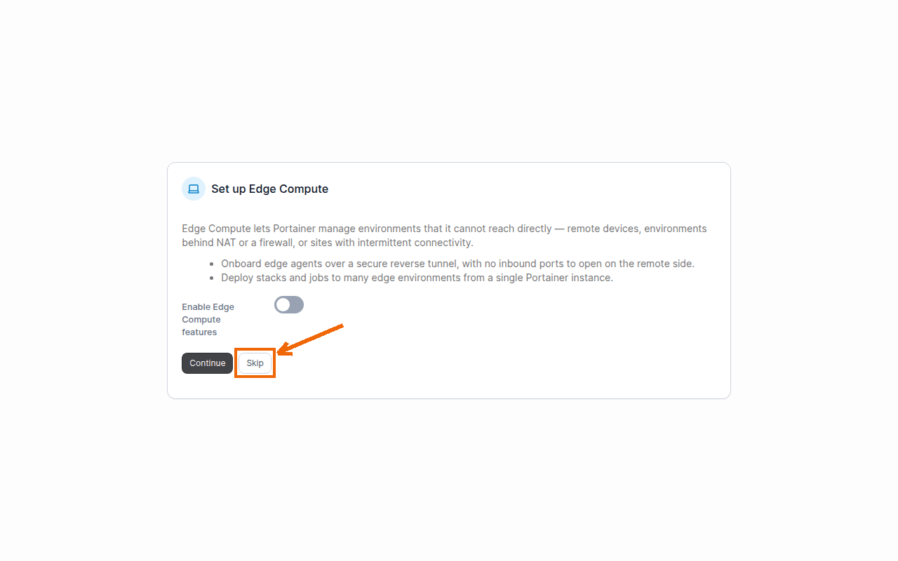

   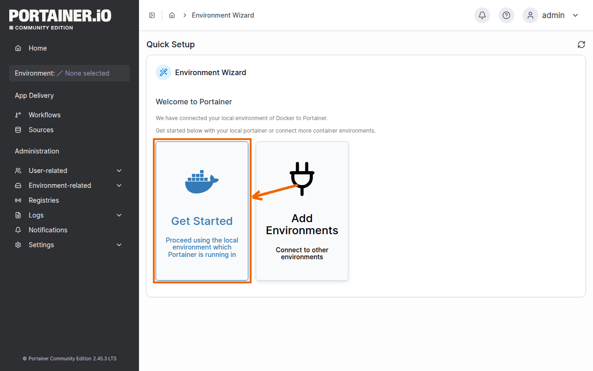

   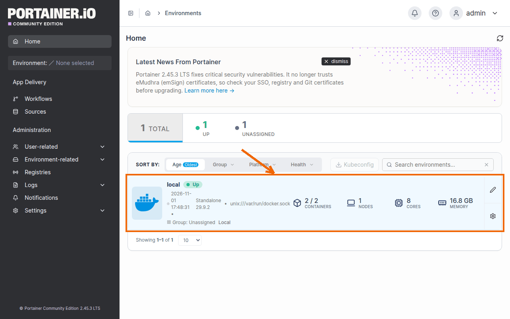

   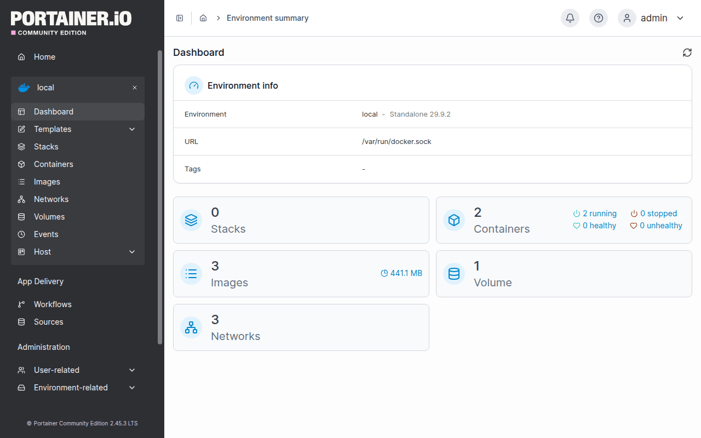

   <!-- shots:end -->

   <!-- ui: portainer_init -->

   <!-- test
   jwt=$(curl -fsS -X POST localhost:9000/api/auth -H 'Content-Type: application/json' \
     -d '{"Username":"admin","Password":"Portainer-Lab-2026"}' | jq -r .jwt)
   curl -fsS -H "Authorization: Bearer $jwt" localhost:9000/api/endpoints | jq -r '.[].Name' | t_contains local
   -->

6. In Portainer, click **Containers**, then **web**, then **Logs**.

   <!-- shots:begin -->
   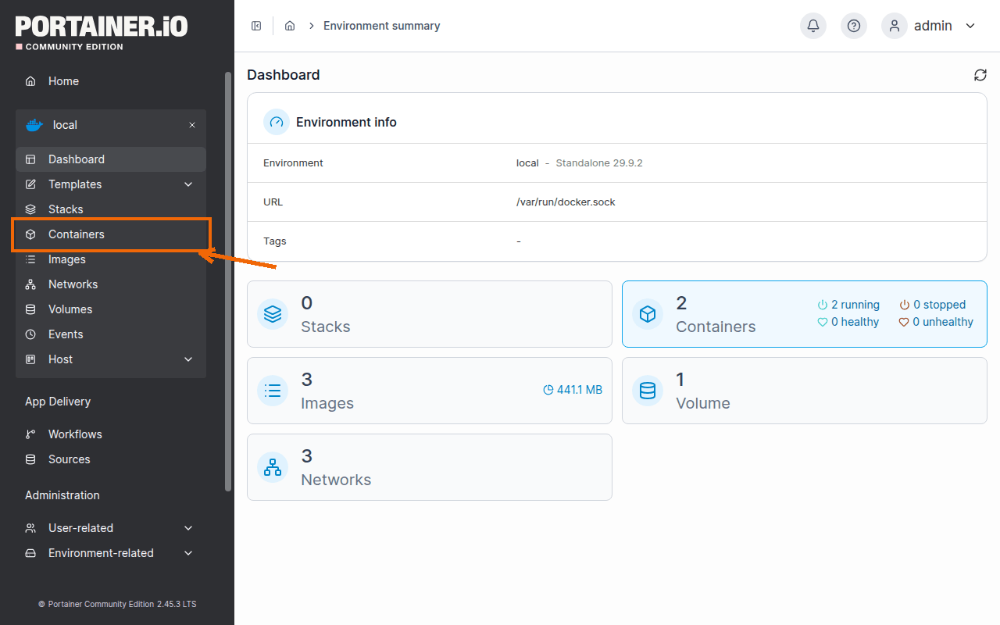

   

   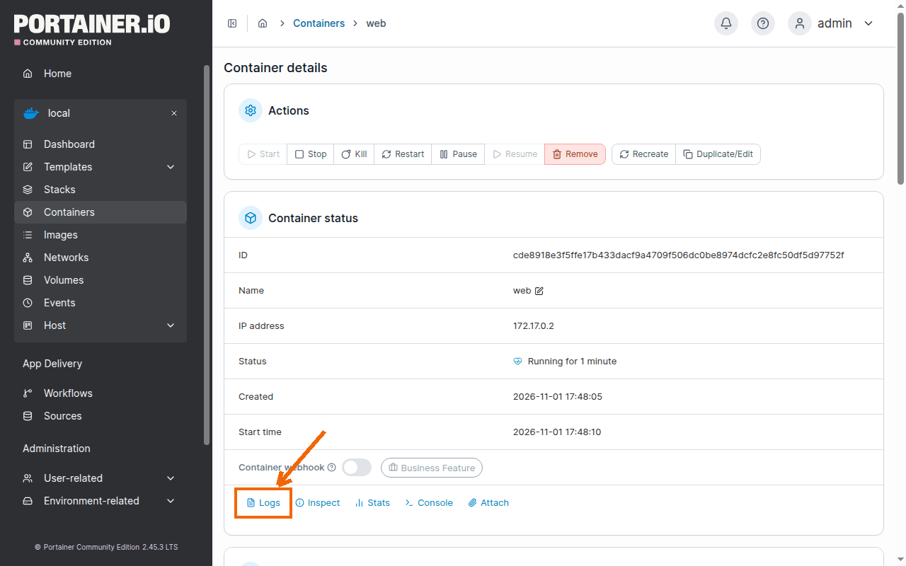

   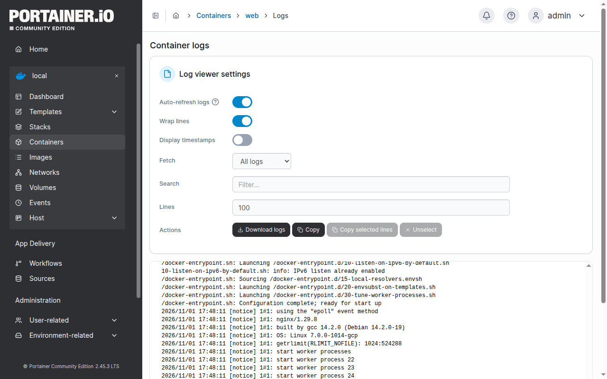

   <!-- shots:end -->

   <!-- ui: portainer_view container-logs web -->

   The log shows the same lines as `docker logs web`.

7. In Portainer, click **Containers**, then **web**, then **Stats**.

   <!-- shots:begin -->
   

   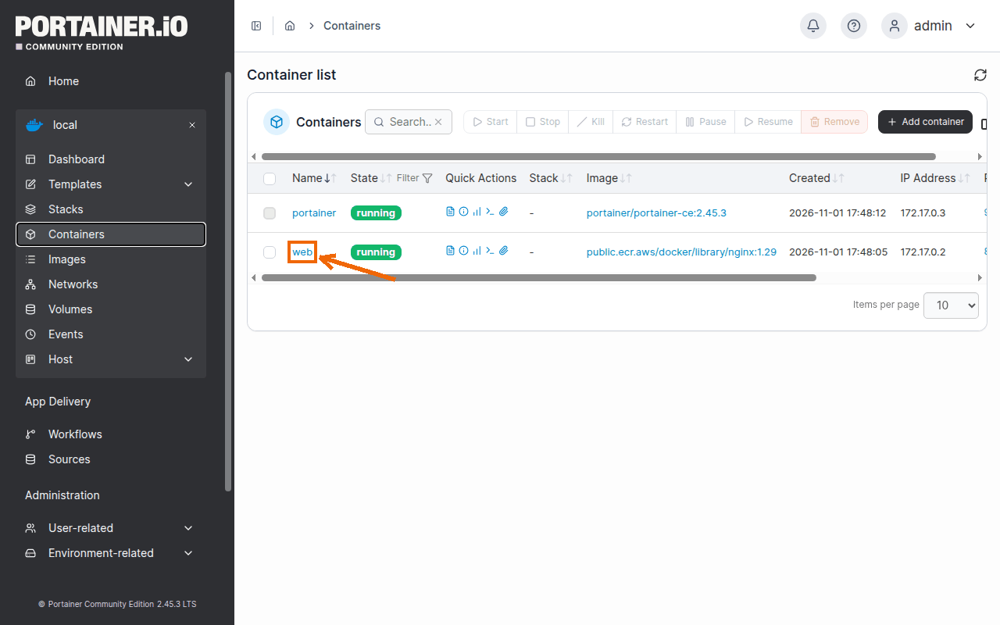

   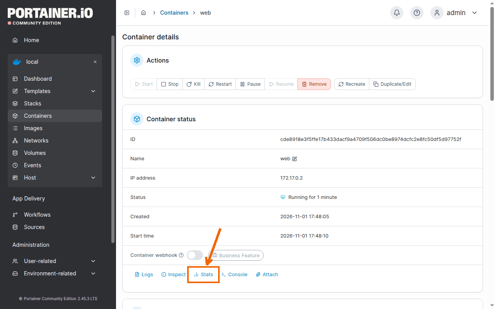

   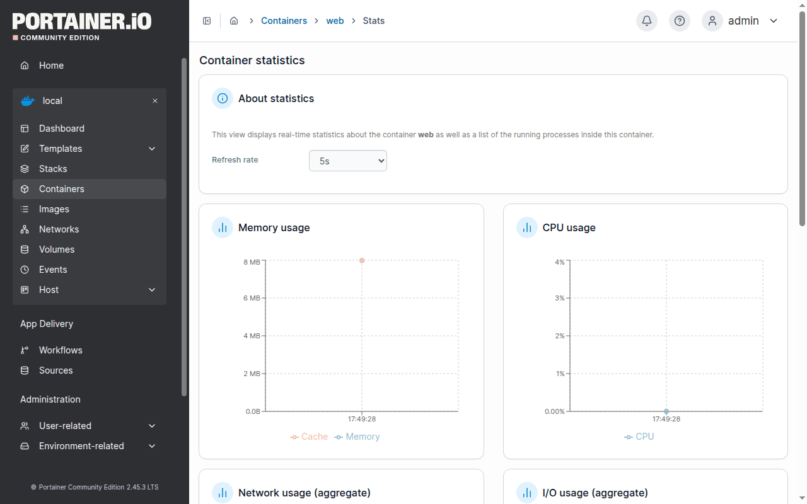

   <!-- shots:end -->

   <!-- ui: portainer_view container-stats web -->

## Part 5: A container is a Linux process

1. Start an Alpine container that sleeps.

   ```bash
   docker run -d --name sleeper public.ecr.aws/docker/library/alpine:3.22 sleep 3600
   ```

   <!-- test
   t_running sleeper
   -->

2. Find the process of the container on the host.

   ```bash
   ps -o pid,ppid,user,cmd -C sleep
   ```

   The line with `sleep 3600` belongs to `root`.

3. Save the host PID of the container's main process in a variable and print it.

   ```bash
   PID=$(docker inspect -f '{{.State.Pid}}' sleeper)
   echo $PID
   ```

   The number is the `PID` of `sleep 3600` in the last step.

   <!-- test
   t_eq "$(ps -o cmd= -p $PID)" "sleep 3600" "host process of sleeper"
   t_eq "$(ps -o user= -p $PID)" root "owner of the process"
   -->

4. Show the parent of that process.

   ```bash
   ps -o pid,cmd -p $(ps -o ppid= -p $PID)
   ```

   The parent is `containerd-shim-runc-v2`.

   <!-- test
   ps -o cmd= -p "$(ps -o ppid= -p $PID | tr -d ' ')" | t_contains containerd-shim-runc-v2
   -->

5. List the namespaces of the container's process.

   ```bash
   sudo ls -l /proc/$PID/ns
   ```

6. List the namespaces of the host's first process.

   ```bash
   sudo ls -l /proc/1/ns
   ```

   The numbers of `mnt`, `net`, `pid` and `uts` differ from those of the container.

   <!-- test
   for ns in mnt net pid uts; do
     [ "$(sudo readlink /proc/$PID/ns/$ns)" != "$(sudo readlink /proc/1/ns/$ns)" ]
   done
   -->

7. List the processes inside the container.

   ```bash
   docker exec sleeper ps
   ```

   Inside the container, `sleep 3600` is PID 1.

   <!-- test
   t_eq "$(docker exec sleeper ps | awk '$1 == 1 {print $4, $5}')" "sleep 3600" "PID 1 in sleeper"
   -->

8. Compare the host name inside the container with the host name of the lab machine.

   ```bash
   docker exec sleeper hostname
   hostname
   ```

   The container's host name is the first 12 characters of its container ID.

   <!-- test
   t_eq "$(docker exec sleeper hostname)" "$(docker inspect -f '{{.Id}}' sleeper | cut -c1-12)" "host name of sleeper"
   -->

## Part 6: Limits and the OOM killer

1. Start a container with a limit of 64 MiB of memory and half a CPU.

   ```bash
   docker run -d --name limited --memory 64m --cpus 0.5 \
     public.ecr.aws/docker/library/alpine:3.22 sleep 3600
   ```

2. Read the memory limit from the container's cgroup on the host.

   ```bash
   cat /sys/fs/cgroup/system.slice/docker-$(docker inspect -f '{{.Id}}' limited).scope/memory.max
   ```

   The answer is `67108864`, which is 64 × 1024 × 1024 bytes.

   <!-- test
   t_eq "$(cat /sys/fs/cgroup/system.slice/docker-$(docker inspect -f '{{.Id}}' limited).scope/memory.max)" 67108864 "memory.max of limited"
   -->

3. Show the resource use of the container once.

   ```bash
   docker stats --no-stream limited
   ```

   The `MEM USAGE / LIMIT` column ends with `64MiB`.

   <!-- test
   docker stats --no-stream --format '{{.MemUsage}}' limited | t_contains 64MiB
   -->

4. Start a Python container with a limit of 32 MiB that tries to fill 200 MiB.

   <!-- expect-fail -->
   ```bash
   docker run --name hog --memory 32m public.ecr.aws/docker/library/python:3.13-slim \
     python -c "b = bytearray(200*1024*1024)"
   ```

5. Read whether the kernel killed the container, and its exit code.

   ```bash
   docker inspect -f '{{.State.OOMKilled}} {{.State.ExitCode}}' hog
   ```

   The answer is `true 137`.

   <!-- test
   t_eq "$(docker inspect -f '{{.State.OOMKilled}} {{.State.ExitCode}}' hog)" "true 137" "OOM kill of hog"
   -->

## Part 7: Exit codes

1. Start a container with a command that does not exist.

   <!-- expect-fail -->
   ```bash
   docker run --name typo public.ecr.aws/docker/library/alpine:3.22 nosuchcommand
   ```

   Docker reports `executable file not found in $PATH`.

2. Read the exit code of `typo`.

   ```bash
   docker inspect -f '{{.State.ExitCode}}' typo
   ```

   The exit code is `127`.

   <!-- test
   t_eq "$(docker inspect -f '{{.State.ExitCode}}' typo)" 127 "exit code of typo"
   -->

3. Start a container with `--init`, which adds a small init process that passes signals on to `sleep`.

   ```bash
   docker run -d --name stopper --init public.ecr.aws/docker/library/alpine:3.22 sleep 3600
   ```

   <!-- test
   t_running stopper
   -->

4. Stop the container and read its exit code.

   ```bash
   docker stop stopper
   docker inspect -f '{{.State.ExitCode}}' stopper
   ```

   The exit code is `143`.

   <!-- test
   t_eq "$(docker inspect -f '{{.State.ExitCode}}' stopper)" 143 "exit code of stopper"
   -->

5. List all containers with their status.

   ```bash
   docker ps -a
   ```

   `hog` shows `Exited (137)`, and `stopper` shows `Exited (143)`.

6. In Portainer, click **Containers**.

   <!-- shots:begin -->
   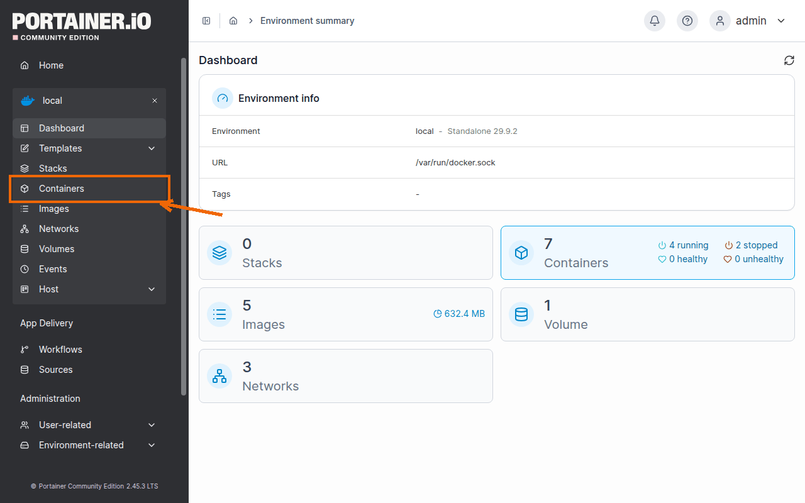

   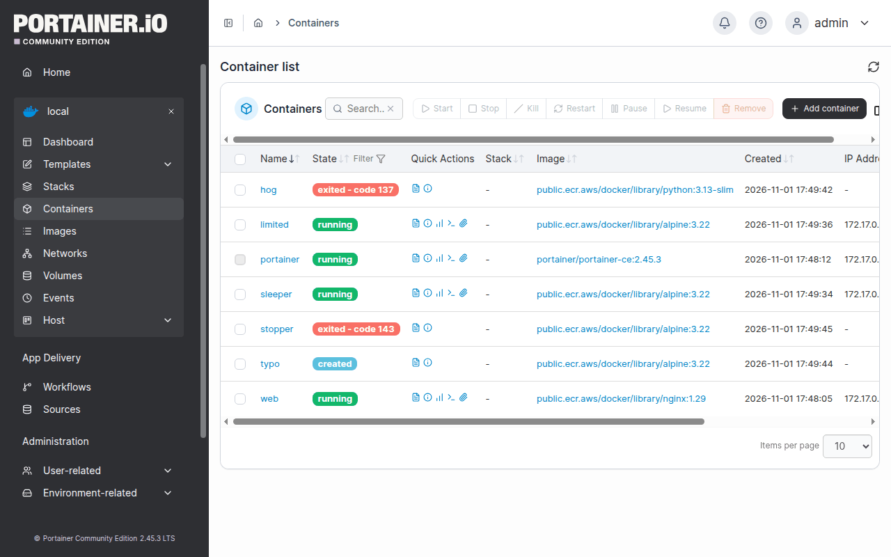

   <!-- shots:end -->

   <!-- ui: portainer_view containers -->

   The list also shows the containers that are not running.

## Part 8: Clean up

1. Remove the containers of this lab, and keep Portainer.

   ```bash
   docker rm -f web sleeper limited hog typo stopper
   ```

   <!-- test
   t_eq "$(docker ps -a --format '{{.Names}}')" portainer "only portainer is left"
   -->

## Check your work

1. List all containers.

   ```bash
   docker ps -a --format '{{.Names}}: {{.Status}}'
   ```

   The only line is `portainer: Up …`.

2. Ask Portainer for its version.

   ```bash
   curl -s localhost:9000/api/system/status | jq -r .Version
   ```

   The answer is `2.45.3`.

   <!-- test
   t_eq "$(curl -fsS localhost:9000/api/system/status | jq -r .Version)" 2.45.3 "version of Portainer"
   t_eq "$(docker inspect -f '{{.HostConfig.RestartPolicy.Name}}' portainer)" always "restart policy of portainer"
   -->

3. Show the members of the `docker` group.

   ```bash
   getent group docker
   ```

   Your user name is at the end of the line.

4. List the course repository.

   ```bash
   ls ~/containerization-fundamentals
   ```

   The list includes `app`, `labs` and `solutions`.

   <!-- test
   t_running portainer
   getent group docker | t_contains "$USER"
   test -d ~/containerization-fundamentals/app
   -->

<!-- runner: stop -->

## Troubleshooting

| Problem | Fix |
|---|---|
| `apt-get` stops with `Could not get lock` | Ubuntu installs updates in the background after boot. Wait until that finishes, then run the command again. |
| `permission denied` on `/var/run/docker.sock` | This terminal started before you joined the `docker` group. Run `newgrp docker`, or log out of the desktop and log in again. |
| `Conflict. The container name "/web" is already in use` | Remove the old container with `docker rm -f web`, then run the command again. |
| `Bind for 0.0.0.0:8090 failed: port is already allocated` | Another container uses that host port. Find it with `docker ps` and remove it. |
| The Portainer page says that the instance timed out for security purposes | Portainer waits 5 minutes for the first user. Run `docker restart portainer`, print the new token with `docker logs portainer 2>&1 \| grep setup_token \| tail -1`, and reload the page. |
| Portainer shows no **Containers** item in its menu | Click **Home**, then the **local** environment. |
| `cat` says `No such file or directory` for `memory.max` | The container `limited` is not running. Check it with `docker ps -a`, remove it, and start it again. |
| `ls: cannot access '/proc//ns'` | `PID` is empty, for example in a new terminal. Run the step that sets `PID` again. |

## Going further (optional)

- Read `cpu.max` in the same cgroup folder as `memory.max`, and match its two numbers to `--cpus 0.5`.
- Run `ps` in an Alpine container started with `--pid host`, and compare the list with the one from `docker exec sleeper ps`.
- Start `sleep 3600` in an Alpine container without `--init`, stop it with `docker stop`, and compare its exit code with the one of `stopper`.
