# Lab 02: Build images

**Goal:** Package bag-api as an image, run it, and publish it to a local registry.

**Lecture:** L4

**Start:** Lab 01 finished, or run `~/containerization-fundamentals/scripts/catch-up.sh 02` on a fresh VM.

## Part 1: Get the source

1. Copy the BagTrack source to `~/bagtrack` and go into that folder.

   ```bash
   cp -r ~/containerization-fundamentals/app ~/bagtrack
   cd ~/bagtrack
   ```

   <!-- test
   t_running portainer
   test -f ~/bagtrack/bag-api/requirements.txt
   -->

2. Open the folder in VS Code.

   <!-- skip -->
   ```bash
   code ~/bagtrack
   ```

3. List the files of bag-api.

   ```bash
   ls ~/bagtrack/bag-api
   ```

   The folder holds the `bagtrack` package, `requirements.txt` and `tests`.

## Part 2: Use an image as it is

1. Pull the official Python image from ECR Public.

   ```bash
   docker pull public.ecr.aws/docker/library/python:3.13-slim
   ```

2. List your images.

   ```bash
   docker image ls
   ```

   The list includes `public.ecr.aws/docker/library/python` with the tag `3.13-slim`.

3. Show the history of the image.

   ```bash
   docker history public.ecr.aws/docker/library/python:3.13-slim
   ```

   The top line is `CMD ["python3"]`, the last instruction of the Dockerfile that built the image.

4. Show the layers of the image.

   ```bash
   docker image inspect -f '{{json .RootFS.Layers}}' \
     public.ecr.aws/docker/library/python:3.13-slim | jq .
   ```

   Each `sha256:` digest is one layer.

5. In Portainer, click **Images**.

   <!-- shots:begin -->
   

   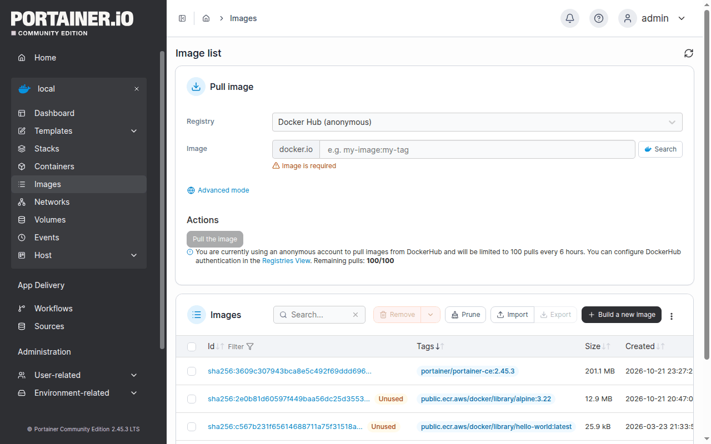

   <!-- shots:end -->

   <!-- ui: portainer_view images -->

6. Run Python from the image to print its version.

   ```bash
   docker run --rm public.ecr.aws/docker/library/python:3.13-slim \
     python -c "import sys; print(sys.version)"
   ```

   The version starts with `3.13`.

## Part 3: The writable layer

1. Install a package in a new container from the Python image.

   ```bash
   docker run --name tinker public.ecr.aws/docker/library/python:3.13-slim \
     pip install --quiet requests
   ```

   pip may print a warning about the `root` user.

2. Show what the container added to its writable layer.

   ```bash
   docker diff tinker | grep requests | head -5
   ```

   `A` marks a path that the container added.

   <!-- test
   docker diff tinker | t_contains site-packages/requests
   -->

3. Save the container as a new image.

   ```bash
   docker commit tinker tinkered:0.1
   ```

4. Show the history of the new image.

   ```bash
   docker history tinkered:0.1
   ```

   The top line is the layer from `docker commit`, created by `pip install --quiet requests`.

5. Remove the container and the new image.

   ```bash
   docker rm tinker
   docker image rm tinkered:0.1
   ```

   <!-- test
   if docker image inspect tinkered:0.1 >/dev/null 2>&1; then echo "tinkered:0.1 still exists" >&2; exit 1; fi
   -->

## Part 4: Write the Dockerfile

1. Create `~/bagtrack/bag-api/Dockerfile` in VS Code: click the `bag-api` folder, click **New File**, type `Dockerfile`, paste this content with Ctrl+V, and save with Ctrl+S.

   <!-- shots:begin -->
   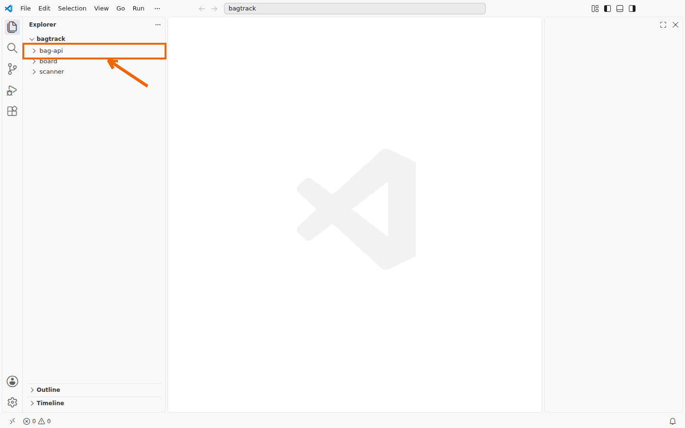

   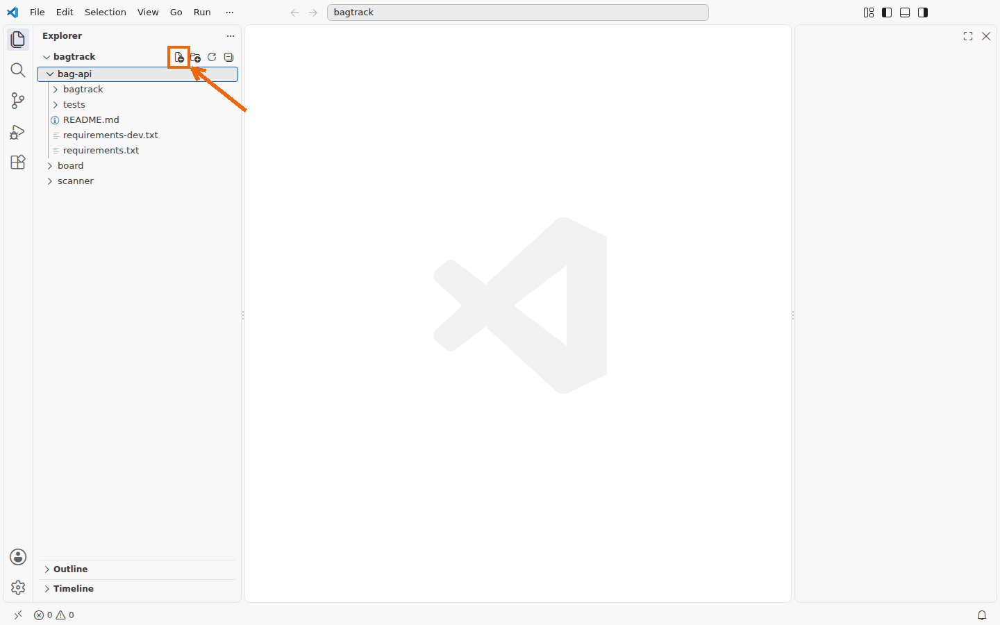

   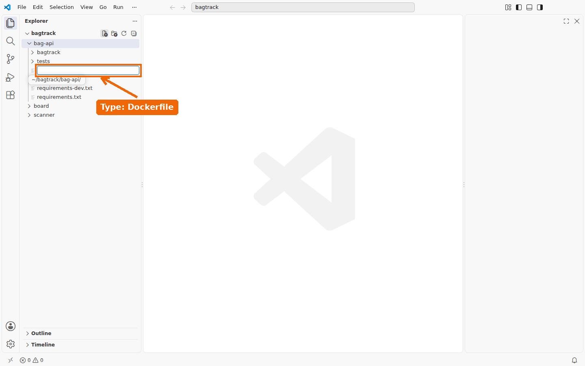

   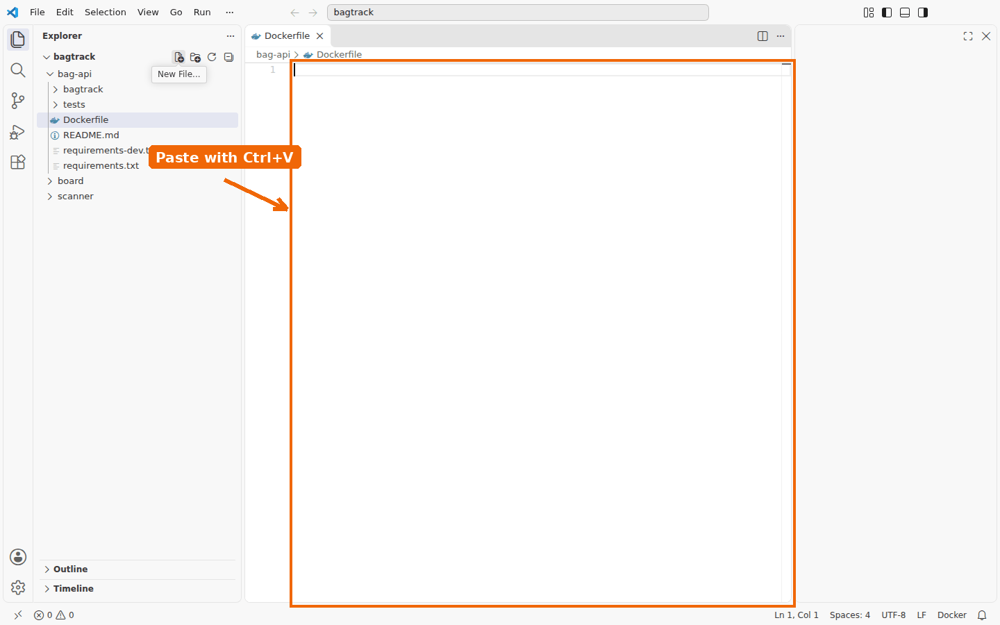

   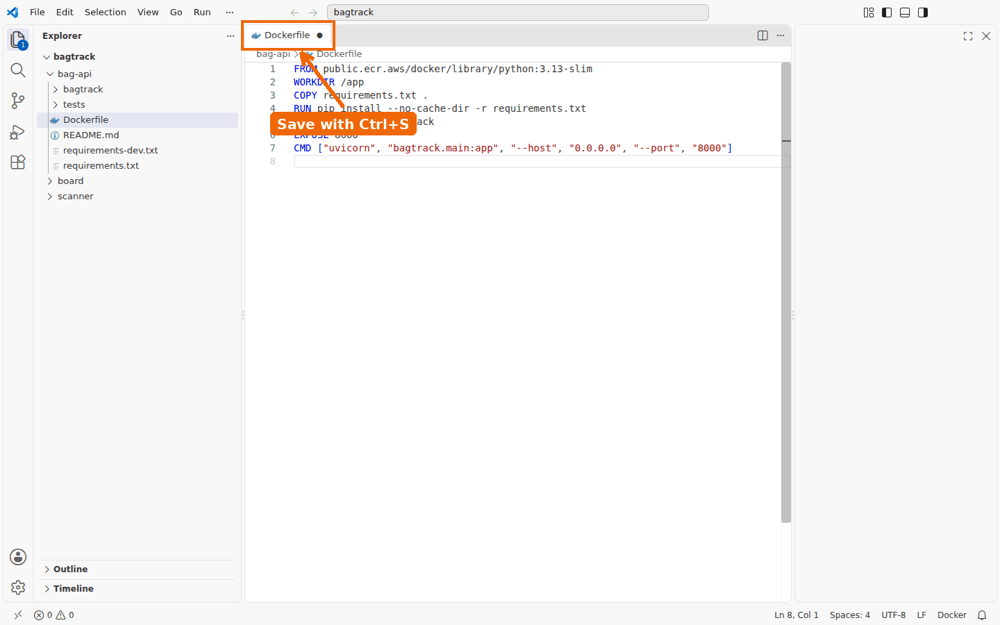

   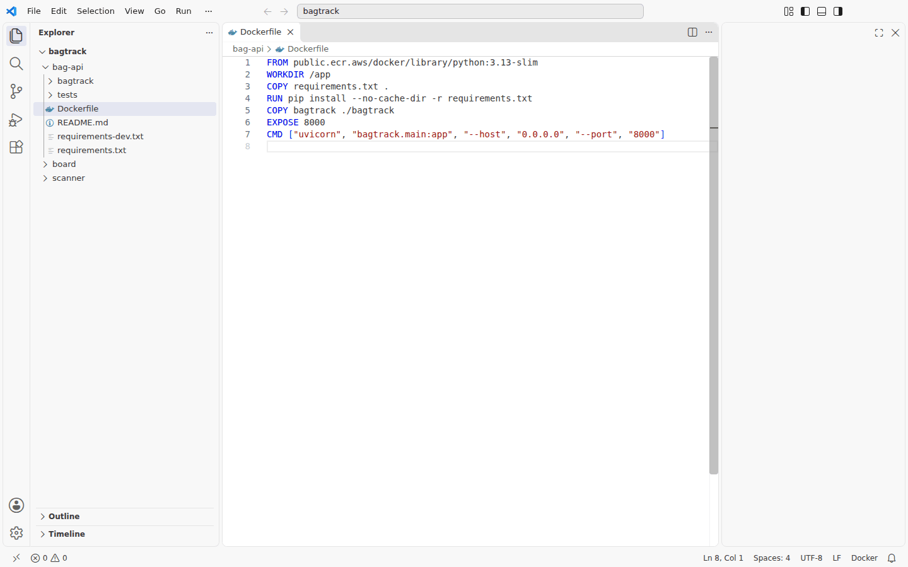

   <!-- shots:end -->

   <!-- ui: vscode_new_file ~/bagtrack/bag-api/Dockerfile ~/containerization-fundamentals/solutions/lab02/bagtrack/bag-api/Dockerfile -->

   <!-- file: ~/bagtrack/bag-api/Dockerfile -->
   ```dockerfile
   FROM public.ecr.aws/docker/library/python:3.13-slim
   WORKDIR /app
   COPY requirements.txt .
   RUN pip install --no-cache-dir -r requirements.txt
   COPY bagtrack ./bagtrack
   EXPOSE 8000
   CMD ["uvicorn", "bagtrack.main:app", "--host", "0.0.0.0", "--port", "8000"]
   ```

2. Create `~/bagtrack/bag-api/.dockerignore` in VS Code with these lines and save it.

   <!-- file: ~/bagtrack/bag-api/.dockerignore -->
   ```text
   __pycache__/
   *.pyc
   tests/
   .pytest_cache/
   ```

3. Build the image with the name `bag-api` and the tag `0.1`.

   ```bash
   docker build -t bag-api:0.1 bag-api
   ```

   Near the end, the output says `naming to docker.io/library/bag-api:0.1`.

   <!-- test
   t_image bag-api:0.1
   -->

4. List your bag-api images.

   ```bash
   docker image ls bag-api
   ```

   The list shows the image `bag-api` with the tag `0.1`.

5. Show the layers of your image.

   ```bash
   docker history bag-api:0.1
   ```

   The top six lines are the instructions of your Dockerfile after `FROM`, the newest at the top.

6. In Portainer, click **Images**, then the ID of the `bag-api:0.1` image.

   <!-- shots:begin -->
   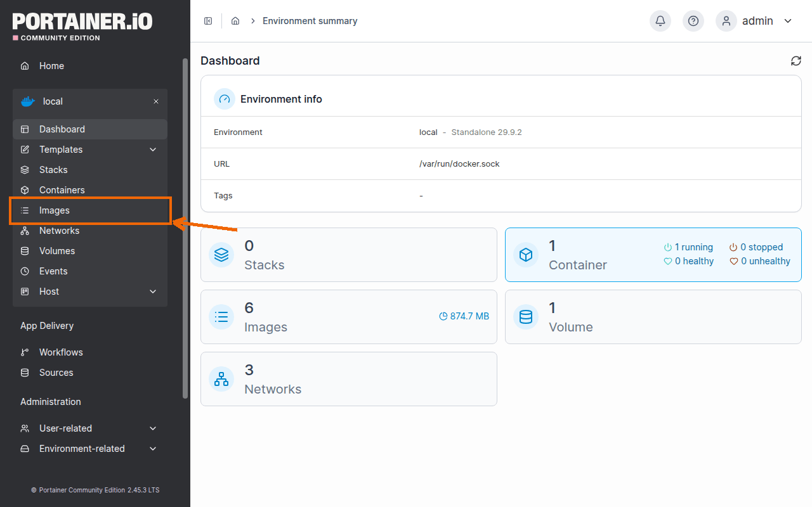

   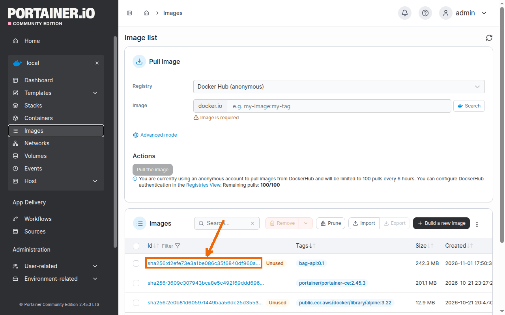

   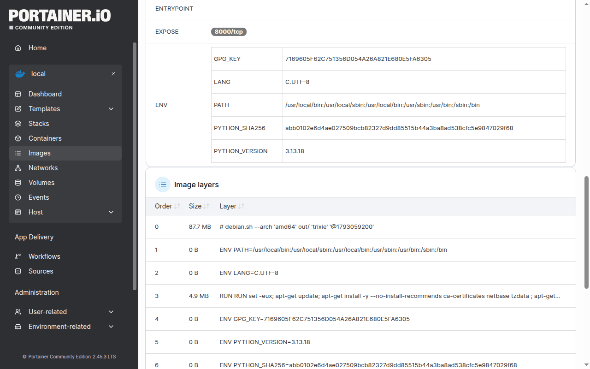

   <!-- shots:end -->

   <!-- ui: portainer_view image bag-api:0.1 -->

## Part 5: Run it

1. Start a container from your image (`-p 8000:8000` publishes the API on the host).

   ```bash
   docker run -d --name bag-api -p 8000:8000 bag-api:0.1
   ```

   <!-- test
   t_get http://localhost:8000/healthz | t_contains '"ok"'
   -->

2. Ask bag-api whether it is alive.

   ```bash
   curl -s localhost:8000/healthz | jq .
   ```

   The answer has `"status": "ok"`.

3. Ask bag-api about itself.

   ```bash
   curl -s localhost:8000/api/info | jq .
   ```

   `storage` is `memory`.

   <!-- test
   t_eq "$(curl -fsS localhost:8000/api/info | jq -r .storage)" memory "storage of bag-api"
   -->

4. Count the bags.

   ```bash
   curl -s localhost:8000/api/bags | jq length
   ```

   The answer is `12`.

   <!-- test
   t_eq "$(curl -fsS localhost:8000/api/bags | jq length)" 12 "number of sample bags"
   -->

5. Open http://localhost:8000/docs in the browser.

   <!-- shots:begin -->
   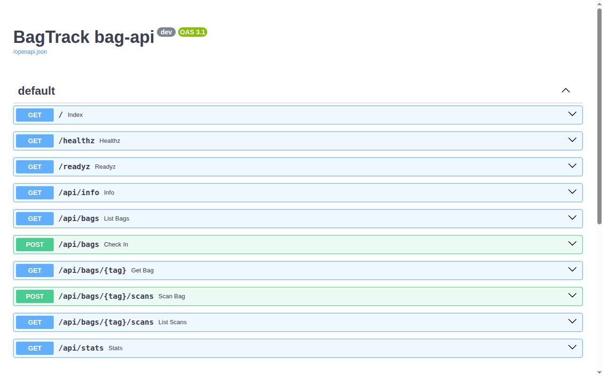

   <!-- shots:end -->

   <!-- ui: browser_open http://localhost:8000/docs -->

   The page lists the endpoints of bag-api.

6. In Portainer, click **Containers**, then **bag-api**, then **Logs**.

   <!-- shots:begin -->
   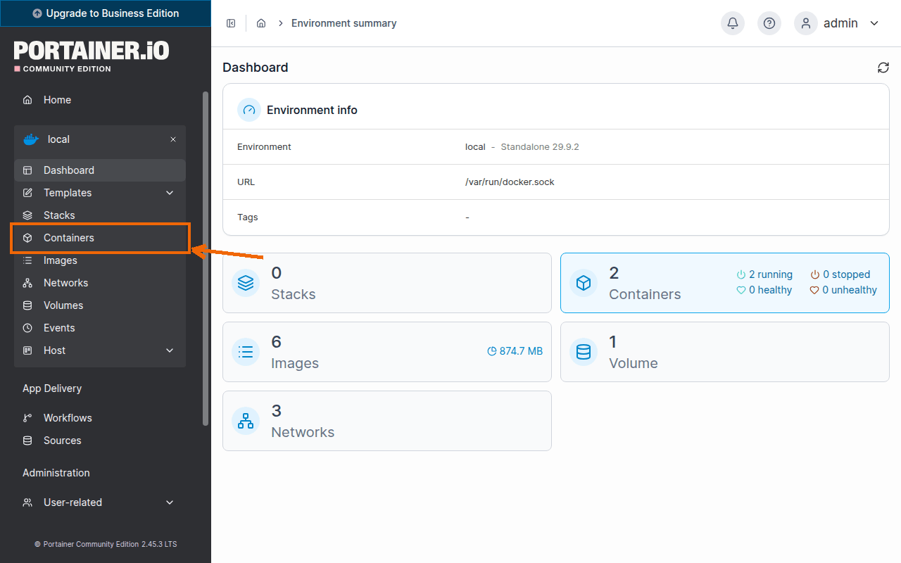

   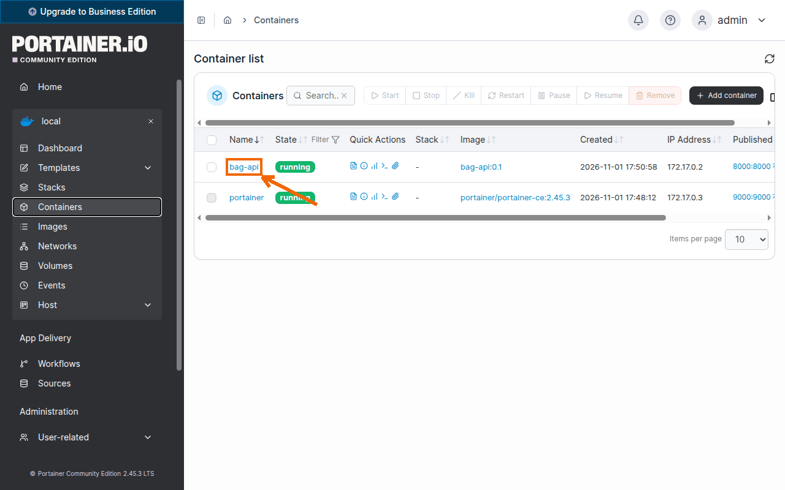

   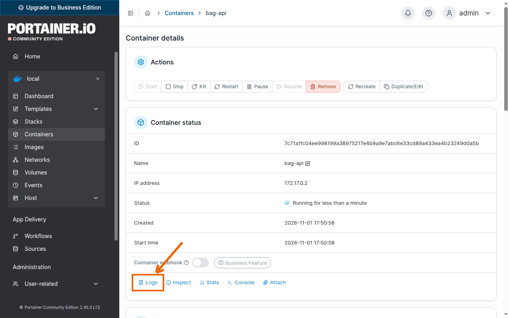

   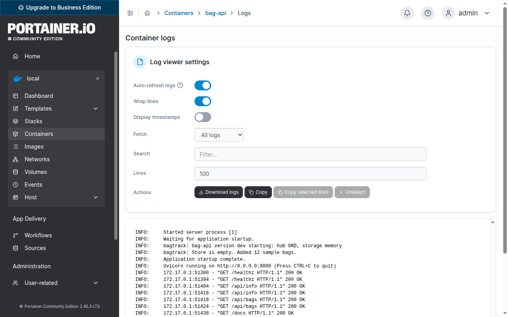

   <!-- shots:end -->

   <!-- ui: portainer_view container-logs bag-api -->

   Each request is one line, such as `"GET /api/bags HTTP/1.1" 200 OK`.

## Part 6: The build cache

1. Change the startup log message of bag-api.

   ```bash
   sed -i 's/version %s starting/version %s is starting/' bag-api/bagtrack/main.py
   ```

   <!-- test
   grep -q 'version %s is starting' bag-api/bagtrack/main.py
   -->

2. Build the image again as `bag-api:0.2`, and show which steps came from the cache.

   ```bash
   docker build --progress=plain -t bag-api:0.2 bag-api 2>&1 | grep -E 'CACHED|pip install'
   ```

   A `CACHED` line has the same `#` number as the `RUN pip install` line.

   <!-- test
   a=$(docker image inspect -f '{{json .RootFS.Layers}}' bag-api:0.1)
   b=$(docker image inspect -f '{{json .RootFS.Layers}}' bag-api:0.2)
   t_eq "$(jq -c '.[:-1]' <<<"$b")" "$(jq -c '.[:-1]' <<<"$a")" "bag-api:0.2 reuses the layers below the app code"
   [ "$(jq -r '.[-1]' <<<"$b")" != "$(jq -r '.[-1]' <<<"$a")" ]
   -->

3. Undo the change.

   ```bash
   cp ~/containerization-fundamentals/app/bag-api/bagtrack/main.py bag-api/bagtrack/main.py
   ```

   <!-- test
   cmp bag-api/bagtrack/main.py ~/containerization-fundamentals/app/bag-api/bagtrack/main.py
   -->

4. Remove the image `bag-api:0.2`.

   ```bash
   docker image rm bag-api:0.2
   ```

   <!-- test
   if docker image inspect bag-api:0.2 >/dev/null 2>&1; then echo "bag-api:0.2 still exists" >&2; exit 1; fi
   t_image bag-api:0.1
   -->

## Part 7: A registry, tags and digests

1. Start a local registry on port 5000.

   ```bash
   docker run -d --name registry --restart always -p 5000:5000 \
     public.ecr.aws/docker/library/registry:3
   ```

   <!-- test
   t_get http://localhost:5000/v2/ >/dev/null
   -->

2. Tag your image with the address of the registry.

   ```bash
   docker tag bag-api:0.1 localhost:5000/bag-api:0.1
   ```

3. Push the image to the registry.

   ```bash
   docker push localhost:5000/bag-api:0.1
   ```

   The last line shows the tag `0.1` and a `digest: sha256:…`.

   <!-- test
   t_tag_in_registry bag-api 0.1
   -->

4. List the repositories in the registry.

   ```bash
   curl -s localhost:5000/v2/_catalog
   ```

   The answer is `{"repositories":["bag-api"]}`.

5. List the tags of `bag-api` in the registry.

   ```bash
   curl -s localhost:5000/v2/bag-api/tags/list
   ```

   The answer is `{"name":"bag-api","tags":["0.1"]}`.

6. Save the digest of the image in a variable and print it.

   ```bash
   DIGEST=$(docker image inspect -f '{{index .RepoDigests 0}}' localhost:5000/bag-api:0.1 \
     | cut -d@ -f2)
   echo $DIGEST
   ```

   It is the digest that `docker push` printed.

   <!-- test
   [[ "$DIGEST" == sha256:* ]]
   reg=$(curl -fsSI -H 'Accept: application/vnd.oci.image.index.v1+json, application/vnd.oci.image.manifest.v1+json, application/vnd.docker.distribution.manifest.list.v2+json, application/vnd.docker.distribution.manifest.v2+json' \
     http://localhost:5000/v2/bag-api/manifests/0.1 | tr -d '\r' | awk -F': ' 'tolower($1) == "docker-content-digest" {print $2}')
   t_eq "$DIGEST" "$reg" "digest of localhost:5000/bag-api:0.1"
   -->

7. Remove the registry tag from your machine.

   ```bash
   docker image rm localhost:5000/bag-api:0.1
   ```

   The output is `Untagged: localhost:5000/bag-api:0.1`.

   <!-- test
   if docker image inspect localhost:5000/bag-api:0.1 >/dev/null 2>&1; then echo "the tag still exists" >&2; exit 1; fi
   -->

8. Pull the image back by its digest.

   ```bash
   docker pull localhost:5000/bag-api@$DIGEST
   ```

   <!-- test
   docker image inspect "localhost:5000/bag-api@$DIGEST" >/dev/null
   -->

9. Pull the image again by its tag.

   ```bash
   docker pull localhost:5000/bag-api:0.1
   ```

   The `Digest:` line shows the same digest as `echo $DIGEST`.

   <!-- test
   t_image localhost:5000/bag-api:0.1
   -->

## Part 8: Clean up

1. Remove the bag-api container.

   ```bash
   docker rm -f bag-api
   ```

   <!-- test
   t_eq "$(docker ps -a --format '{{.Names}}' | sort | tr '\n' ' ')" "portainer registry " "containers at the end of Lab 02"
   -->

## Check your work

1. List the files of bag-api, including the hidden ones.

   ```bash
   ls -A ~/bagtrack/bag-api
   ```

   The list includes `.dockerignore` and `Dockerfile`.

2. Show the tags of your image.

   ```bash
   docker image inspect -f '{{.RepoTags}}' bag-api:0.1
   ```

   The list has `bag-api:0.1` and `localhost:5000/bag-api:0.1`.

3. List the tags of `bag-api` in the registry.

   ```bash
   curl -s localhost:5000/v2/bag-api/tags/list
   ```

   The answer is `{"name":"bag-api","tags":["0.1"]}`.

4. List the running containers.

   ```bash
   docker ps --format '{{.Names}}'
   ```

   The list is `registry` and `portainer`.

   <!-- test
   cmp ~/bagtrack/bag-api/Dockerfile ~/containerization-fundamentals/solutions/lab02/bagtrack/bag-api/Dockerfile
   cmp ~/bagtrack/bag-api/.dockerignore ~/containerization-fundamentals/solutions/lab02/bagtrack/bag-api/.dockerignore
   docker image inspect -f '{{.RepoTags}}' bag-api:0.1 | t_contains localhost:5000/bag-api:0.1
   t_tag_in_registry bag-api 0.1
   t_running registry
   t_running portainer
   -->

<!-- runner: stop -->

## Troubleshooting

| Problem | Fix |
|---|---|
| `No such file or directory` for a path that starts with `bag-api/` | Run `cd ~/bagtrack`, then run the command again. |
| `unable to prepare context: path "bag-api" not found` | Run `cd ~/bagtrack`, then build again. |
| `failed to read dockerfile: open Dockerfile: no such file or directory` | Save the file as `~/bagtrack/bag-api/Dockerfile`, with a capital `D` and no file extension. |
| `curl: (7) Failed to connect to localhost port 8000` | bag-api is still starting or has stopped. Check it with `docker ps -a` and `docker logs bag-api`. |
| `Conflict. The container name "/bag-api" is already in use` | Remove the old container with `docker rm -f bag-api`, then start it again. |
| `http: server gave HTTP response to HTTPS client` | Use `localhost:5000` in the image name. Docker sends plain HTTP only to a registry on `localhost`. |
| `invalid reference format` when you pull by digest | `DIGEST` is empty, for example in a new terminal. Run the step that sets it again. |

## Going further (optional)

- Move `COPY bagtrack ./bagtrack` above the `RUN pip install` line, change `main.py`, rebuild, and see which steps run again.
- Start a second container from `bag-api:0.1` on host port 8002 with `-e HUB=SFO`, and compare its `/api/info` with the first one.
- Run `docker run --rm bag-api:0.1 ls -R /app` and check which files of `~/bagtrack/bag-api` are in the image.
