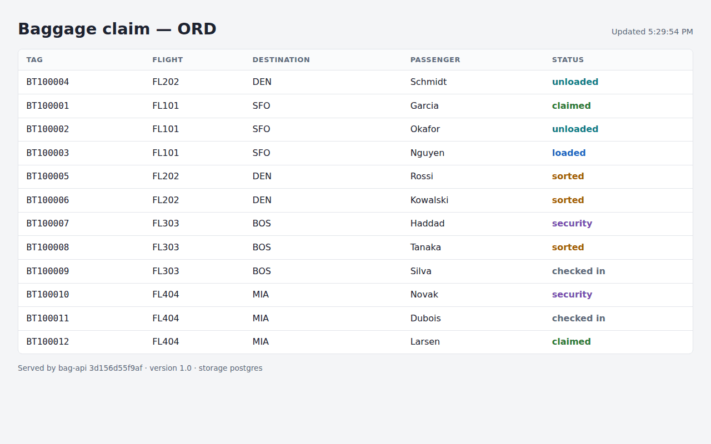
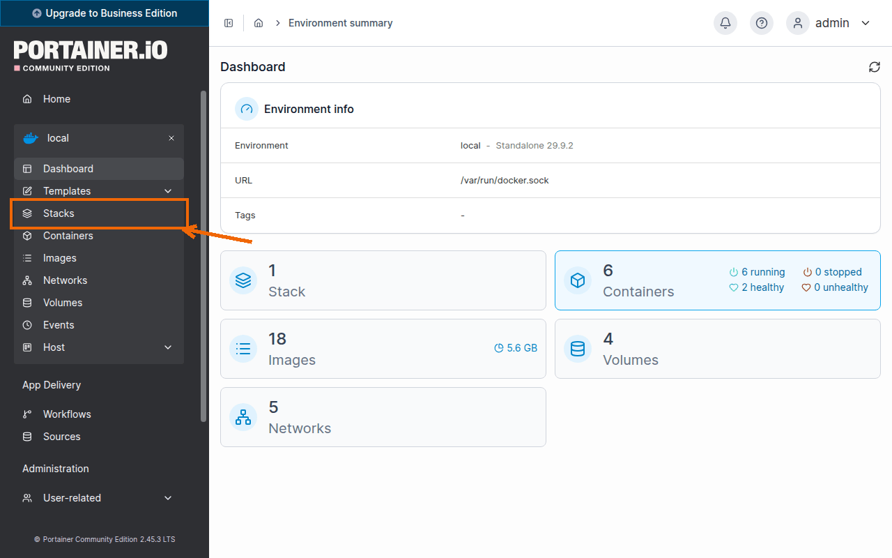
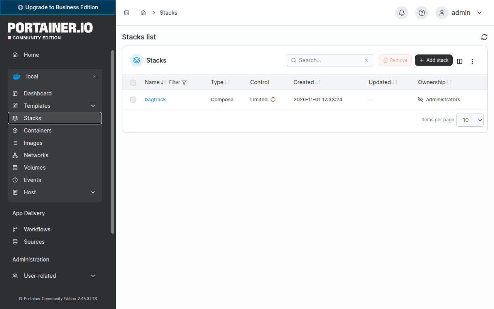
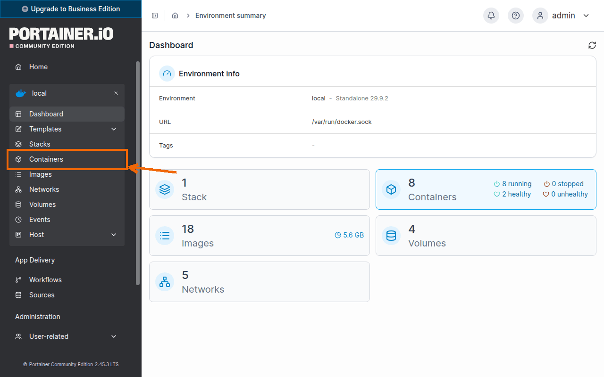
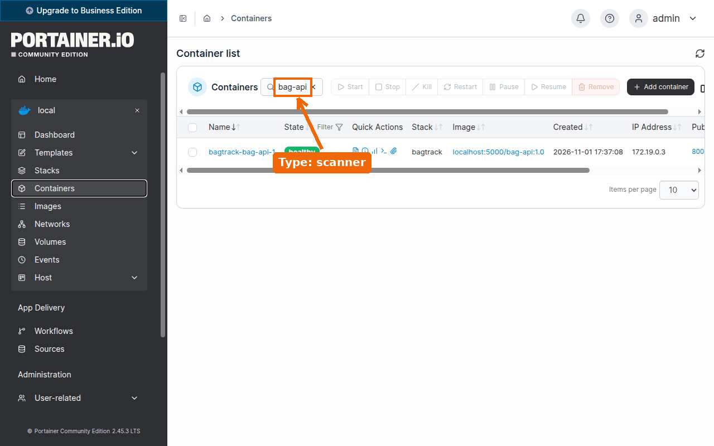
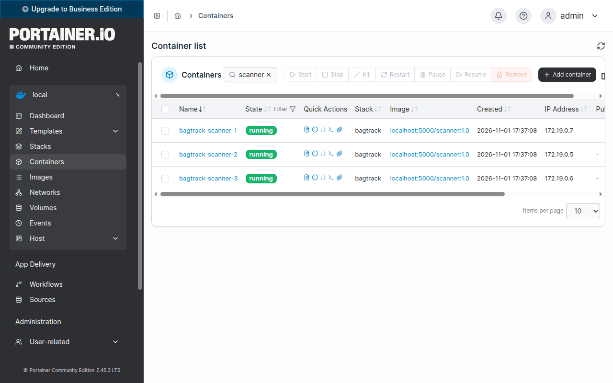

# Lab 05: Compose, then ECS

**Goal:** Run the whole BagTrack system from one Compose file, then describe two of its services as Amazon ECS task definitions.

**Lecture:** L8

**Start:** Lab 04 finished, or run `~/containerization-fundamentals/scripts/catch-up.sh 05` on a fresh VM.

## Part 1: Stop the hand-made containers

1. Go to your working folder.

   ```bash
   cd ~/bagtrack
   ```

   <!-- test
   t_running registry
   t_running portainer
   t_image bag-api:1.0
   t_image scanner:1.0
   t_tag_in_registry bag-api 1.0
   t_tag_in_registry scanner 1.0
   -->

2. Remove the four BagTrack containers that you started with `docker run`.

   ```bash
   docker rm -f scanner board bag-api bagtrack-db
   ```

3. List the running containers.

   ```bash
   docker ps --format '{{.Names}}'
   ```

   Only `registry` and `portainer` are left.

   <!-- test
   t_eq "$(docker ps --format '{{.Names}}' | sort | tr '\n' ' ')" "portainer registry " "running containers"
   -->

## Part 2: A Dockerfile for the board

1. Create `~/bagtrack/board/Dockerfile` in VS Code with this content and save it.

   <!-- file: ~/bagtrack/board/Dockerfile -->
   ```dockerfile
   FROM public.ecr.aws/nginx/nginx-unprivileged:1.27.0-alpine
   COPY html/ /usr/share/nginx/html/
   COPY nginx/default.conf.template /etc/nginx/templates/default.conf.template
   ENV BAG_API_URL=http://bag-api:8000
   EXPOSE 8080
   ```

## Part 3: The Compose file

1. Create `~/bagtrack/compose.yaml` in VS Code with this content and save it.

   <!-- file: ~/bagtrack/compose.yaml -->
   ```yaml
   name: bagtrack

   services:
     db:
       image: public.ecr.aws/docker/library/postgres:17
       environment:
         POSTGRES_USER: bagtrack
         POSTGRES_PASSWORD: bagtrack-dev-pw
         POSTGRES_DB: bagtrack
       volumes:
         - db-data:/var/lib/postgresql/data
       healthcheck:
         test: ["CMD-SHELL", "pg_isready -U bagtrack -d bagtrack"]
         interval: 5s
         timeout: 3s
         retries: 12

     bag-api:
       build: ./bag-api
       image: localhost:5000/bag-api:1.0
       environment:
         DATABASE_URL: postgresql://bagtrack:bagtrack-dev-pw@db:5432/bagtrack
         HUB: ORD
         APP_VERSION: "1.0"
       ports:
         - "8000:8000"
       depends_on:
         db:
           condition: service_healthy

     scanner:
       build: ./scanner
       image: localhost:5000/scanner:1.0
       environment:
         API_URL: http://bag-api:8000
         SCAN_INTERVAL: 3s
         APP_VERSION: "1.0"
       depends_on:
         bag-api:
           condition: service_healthy

     board:
       build: ./board
       image: localhost:5000/board:1.0
       ports:
         - "8080:8080"
       depends_on:
         bag-api:
           condition: service_healthy

   volumes:
     db-data:
   ```

2. Build the three images and start the stack in the background.

   ```bash
   docker compose up -d --build
   ```

3. Show the state of the services.

   ```bash
   docker compose ps
   ```

   `db` and `bag-api` show `(healthy)`, and `scanner` and `board` are up.

   <!-- test
   t_healthy bagtrack-db-1 90
   t_healthy bagtrack-bag-api-1 90
   t_running bagtrack-scanner-1
   t_running bagtrack-board-1
   t_get http://localhost:8080/api/info | jq -e '.version == "1.0" and .storage == "postgres"' >/dev/null
   -->

4. Open http://localhost:8080 in the browser.

   <!-- shots:begin -->
   

   <!-- shots:end -->

   <!-- ui: browser_open http://localhost:8080 -->

   The board shows bags moving, and its footer shows version `1.0`.

5. In Portainer, click **Stacks**.

   <!-- shots:begin -->
   

   

   <!-- shots:end -->

   <!-- ui: portainer_view stacks -->

   The list shows the stack `bagtrack`.

## Part 4: Work with the stack

1. Read the last log lines of the scanner.

   ```bash
   docker compose logs --tail 5 scanner
   ```

2. Count the bags at each checkpoint in the database.

   ```bash
   docker compose exec db psql -U bagtrack -d bagtrack -c 'select status, count(*) from bags group by status'
   ```

   The table has one row for each checkpoint that has bags.

## Part 5: Scale the scanner

1. Run three scanner containers.

   ```bash
   docker compose up -d --scale scanner=3
   ```

2. List the scanner containers.

   ```bash
   docker compose ps scanner
   ```

   The list shows `bagtrack-scanner-1`, `bagtrack-scanner-2` and `bagtrack-scanner-3`.

   <!-- test
   cd ~/bagtrack
   t_eq "$(docker compose ps -q scanner | wc -l)" "3" "number of scanner containers"
   -->

3. Read the last two log lines of each scanner.

   ```bash
   docker compose logs --tail 2 scanner
   ```

   The lines come from three scanner IDs, the name after `scanner` in each line.

4. In Portainer, click **Containers**, type `scanner` in the search box, and find the three `bagtrack-scanner` containers of the stack.

   <!-- shots:begin -->
   

   

   

   <!-- shots:end -->

   <!-- ui: portainer_view containers scanner -->

## Part 6: Live reload for development

1. Create `~/bagtrack/compose.dev.yaml` in VS Code with this content and save it.

   <!-- file: ~/bagtrack/compose.dev.yaml -->
   ```yaml
   services:
     bag-api:
       command: ["uvicorn", "bagtrack.main:app", "--host", "0.0.0.0", "--port", "8000", "--reload"]
       environment:
         APP_VERSION: dev
       volumes:
         - ./bag-api/bagtrack:/app/bagtrack:ro
   ```

2. Start bag-api again with both Compose files.

   ```bash
   docker compose -f compose.yaml -f compose.dev.yaml up -d bag-api
   ```

   <!-- test
   t_get http://localhost:8000/ | jq -e '.version == "dev"' >/dev/null
   -->

3. Call the root path of bag-api.

   ```bash
   curl -s localhost:8000/
   ```

   The output is `{"service":"bag-api","version":"dev","docs":"/docs","bags":"/api/bags"}`.

4. Change the service name in the answer of the root path.

   ```bash
   sed -i 's/{"service": "bag-api",/{"service": "bag-api edited",/' bag-api/bagtrack/main.py
   ```

   <!-- test
   for i in $(seq 1 30); do curl -fsS localhost:8000/ 2>/dev/null | grep -q 'bag-api edited' && exit 0; sleep 1; done
   echo "check failed: bag-api did not reload the edited main.py" >&2; exit 1
   -->

5. Call the root path again.

   ```bash
   curl -s localhost:8000/
   ```

   The service name is now `bag-api edited`, with no rebuild.

6. Undo the change.

   ```bash
   cp ~/containerization-fundamentals/app/bag-api/bagtrack/main.py bag-api/bagtrack/main.py
   ```

   <!-- test
   cd ~/bagtrack
   cmp bag-api/bagtrack/main.py ~/containerization-fundamentals/app/bag-api/bagtrack/main.py
   -->

7. Start bag-api from its image again.

   ```bash
   docker compose up -d bag-api
   ```

   <!-- test
   t_healthy bagtrack-bag-api-1 90
   t_get http://localhost:8000/api/info | jq -e '.version == "1.0"' >/dev/null
   -->

8. Restart the board so that it connects to the new bag-api container.

   ```bash
   docker compose restart board
   ```

   <!-- test
   t_get http://localhost:8080/api/info | jq -e '.version == "1.0"' >/dev/null
   -->

## Part 7: Publish

1. Push the three images that Compose built.

   ```bash
   docker compose push
   ```

2. List the tags of the board in the registry.

   ```bash
   curl -s localhost:5000/v2/board/tags/list
   ```

   The output is `{"name":"board","tags":["1.0"]}`.

   <!-- test
   for r in bag-api scanner board; do t_tag_in_registry "$r" 1.0; done
   -->

## Part 8: The same services on Amazon ECS

1. Create `~/bagtrack/ecs/bag-api-taskdef.json` in VS Code with this content and save it.

   <!-- file: ~/bagtrack/ecs/bag-api-taskdef.json -->
   ```json
   {
     "family": "bag-api",
     "requiresCompatibilities": ["FARGATE"],
     "networkMode": "awsvpc",
     "cpu": "256",
     "memory": "512",
     "executionRoleArn": "arn:aws:iam::123456789012:role/ecsTaskExecutionRole",
     "taskRoleArn": "arn:aws:iam::123456789012:role/bag-api-task",
     "containerDefinitions": [
       {
         "name": "bag-api",
         "image": "123456789012.dkr.ecr.us-east-1.amazonaws.com/bag-api:1.0",
         "essential": true,
         "portMappings": [{ "containerPort": 8000, "protocol": "tcp" }],
         "environment": [
           { "name": "HUB", "value": "ORD" },
           { "name": "APP_VERSION", "value": "1.0" }
         ],
         "secrets": [
           {
             "name": "DATABASE_URL",
             "valueFrom": "arn:aws:secretsmanager:us-east-1:123456789012:secret:bagtrack/database-url"
           }
         ],
         "healthCheck": {
           "command": ["CMD", "python", "-c", "import urllib.request; urllib.request.urlopen('http://localhost:8000/healthz', timeout=2)"],
           "interval": 10,
           "timeout": 3,
           "retries": 3,
           "startPeriod": 10
         },
         "logConfiguration": {
           "logDriver": "awslogs",
           "options": {
             "awslogs-group": "/ecs/bagtrack",
             "awslogs-region": "us-east-1",
             "awslogs-stream-prefix": "bag-api"
           }
         }
       }
     ]
   }
   ```

2. Copy it as the starting point for the task definition of the scanner.

   ```bash
   cp ecs/bag-api-taskdef.json ecs/scanner-taskdef.json
   ```

3. Your turn: change `~/bagtrack/ecs/scanner-taskdef.json` in VS Code for the scanner, and save it.
   - `family`, the container `name` and `awslogs-stream-prefix`: `scanner`
   - `image`: `123456789012.dkr.ecr.us-east-1.amazonaws.com/scanner:1.0`
   - `environment`: `API_URL` with the value `http://bag-api.bagtrack.local:8000`, and `SCAN_INTERVAL` with the value `3s`
   - remove `taskRoleArn`, `portMappings`, `secrets` and `healthCheck`

   <details>
   <summary>Show a solution</summary>

   <!-- file: ~/bagtrack/ecs/scanner-taskdef.json -->
   ```json
   {
     "family": "scanner",
     "requiresCompatibilities": ["FARGATE"],
     "networkMode": "awsvpc",
     "cpu": "256",
     "memory": "512",
     "executionRoleArn": "arn:aws:iam::123456789012:role/ecsTaskExecutionRole",
     "containerDefinitions": [
       {
         "name": "scanner",
         "image": "123456789012.dkr.ecr.us-east-1.amazonaws.com/scanner:1.0",
         "essential": true,
         "environment": [
           { "name": "API_URL", "value": "http://bag-api.bagtrack.local:8000" },
           { "name": "SCAN_INTERVAL", "value": "3s" }
         ],
         "logConfiguration": {
           "logDriver": "awslogs",
           "options": {
             "awslogs-group": "/ecs/bagtrack",
             "awslogs-region": "us-east-1",
             "awslogs-stream-prefix": "scanner"
           }
         }
       }
     ]
   }
   ```

   </details>

4. Print the family, compatibility, network mode and image of both task definitions.

   ```bash
   jq -c '[.family, .requiresCompatibilities[0], .networkMode, .containerDefinitions[0].image]' ecs/*.json
   ```

   ```text
   ["bag-api","FARGATE","awsvpc","123456789012.dkr.ecr.us-east-1.amazonaws.com/bag-api:1.0"]
   ["scanner","FARGATE","awsvpc","123456789012.dkr.ecr.us-east-1.amazonaws.com/scanner:1.0"]
   ```

5. Print the container port of bag-api and the environment of the scanner.

   ```bash
   jq '.containerDefinitions[0].portMappings[0].containerPort' ecs/bag-api-taskdef.json
   jq -c '.containerDefinitions[0].environment' ecs/scanner-taskdef.json
   ```

   The port is `8000`, and the `API_URL` of the scanner is `http://bag-api.bagtrack.local:8000`.

   <!-- test
   cd ~/bagtrack
   f=ecs/scanner-taskdef.json
   t_eq "$(jq -r .family $f)" "scanner" "family"
   t_eq "$(jq -r '.requiresCompatibilities | join(",")' $f)" "FARGATE" "requiresCompatibilities"
   t_eq "$(jq -r .networkMode $f)" "awsvpc" "networkMode"
   t_eq "$(jq -r '.containerDefinitions[0].name' $f)" "scanner" "container name"
   t_eq "$(jq -r '.containerDefinitions[0].image' $f)" "123456789012.dkr.ecr.us-east-1.amazonaws.com/scanner:1.0" "image"
   t_eq "$(jq -r '.containerDefinitions[0].environment[] | select(.name == "API_URL") | .value' $f)" "http://bag-api.bagtrack.local:8000" "API_URL"
   t_eq "$(jq -r '.containerDefinitions[0].environment[] | select(.name == "SCAN_INTERVAL") | .value' $f)" "3s" "SCAN_INTERVAL"
   t_eq "$(jq -r '.containerDefinitions[0].portMappings // [] | length' $f)" "0" "port mappings of the scanner"
   t_eq "$(jq -r '.taskRoleArn // "none"' $f)" "none" "task role of the scanner"
   t_eq "$(jq -r '.containerDefinitions[0].portMappings[0].containerPort' ecs/bag-api-taskdef.json)" "8000" "port of bag-api"
   -->

## Part 9: Stop the stack

1. Stop and remove the stack.

   ```bash
   docker compose down
   ```

2. List the volumes.

   ```bash
   docker volume ls
   ```

   The volume `bagtrack_db-data` is still there.

   <!-- test
   docker volume inspect bagtrack_db-data >/dev/null
   t_eq "$(docker ps -q --filter label=com.docker.compose.project=bagtrack | wc -l)" "0" "running Compose containers"
   -->

## Check your work

1. List the running containers.

   ```bash
   docker ps --format '{{.Names}}'
   ```

   Only `registry` and `portainer` run.

2. List the repositories in the registry.

   ```bash
   curl -s localhost:5000/v2/_catalog
   ```

   The output is `{"repositories":["bag-api","board","scanner"]}`.

3. List the Compose files, the Dockerfiles and the task definitions.

   ```bash
   ls ~/bagtrack/*.yaml ~/bagtrack/*/Dockerfile ~/bagtrack/ecs/*.json
   ```

   The list has seven files.

<!-- test
t_eq "$(docker ps --format '{{.Names}}' | sort | tr '\n' ' ')" "portainer registry " "running containers"
for r in bag-api scanner board; do t_tag_in_registry "$r" 1.0; done
cd ~/bagtrack
for f in bag-api/Dockerfile scanner/Dockerfile board/Dockerfile compose.yaml compose.dev.yaml ecs/bag-api-taskdef.json ecs/scanner-taskdef.json; do
  test -s "$f" || { echo "check failed: $f is missing" >&2; exit 1; }
done
grep -q 'nginx-unprivileged:1.27.0-alpine' board/Dockerfile
-->

<!-- runner: stop -->

## Troubleshooting

| Problem | Fix |
|---|---|
| `Bind for 0.0.0.0:8000 failed: port is already allocated` | A container from Lab 04 still runs. Run `docker rm -f scanner board bag-api bagtrack-db`, then `docker compose up -d` again. |
| `no configuration file provided: not found` | Run the command in `~/bagtrack`, where `compose.yaml` is. |
| `dependency failed to start: container bagtrack-bag-api-1 is unhealthy` | Read the log with `docker compose logs bag-api`. |
| `service "db" is not running` | Start the stack with `docker compose up -d`. |
| `curl -s localhost:8000/` does not show `bag-api edited` | bag-api runs without the dev file. Run step 2 of Part 6 again, then call the root path again. |
| The board shows **API unreachable** | Restart it with `docker compose restart board`. |
| `jq` prints `parse error: Expected separator between values at line …` | A comma is missing in the JSON file, near the line that jq names. |

## Going further (optional)

- Run `docker compose -f compose.yaml -f compose.dev.yaml config` and find the merged `command` of `bag-api`.
- With the stack running, run `docker compose run --rm scanner report` to print the number of bags at each checkpoint.
- For each setting of the `bag-api` service in `compose.yaml`, find the matching field in `ecs/bag-api-taskdef.json`.
