# Lab 08: Deployments and Services

**Goal:** Run bag-api, the board and the scanner as Deployments behind Services, then scale, update and roll back bag-api.

**Lecture:** L12

**Start:** Lab 07 finished, or run `~/containerization-fundamentals/scripts/catch-up.sh 08` on a fresh VM.

## Part 1: bag-api as a Deployment

1. Go to your working folder.

   ```bash
   cd ~/bagtrack
   ```

2. Create `~/bagtrack/k8s/bag-api-deployment.yaml` in VS Code with this content and save it.

   <!-- file: ~/bagtrack/k8s/bag-api-deployment.yaml -->
   ```yaml
   apiVersion: apps/v1
   kind: Deployment
   metadata:
     name: bag-api
     namespace: bagtrack
   spec:
     replicas: 3
     selector:
       matchLabels:
         app: bag-api
     strategy:
       type: RollingUpdate
       rollingUpdate: {maxSurge: 1, maxUnavailable: 0}
     template:
       metadata:
         labels:
           app: bag-api
       spec:
         containers:
         - name: bag-api
           image: localhost:5000/bag-api:1.0
           ports:
           - containerPort: 8000
           envFrom:
           - configMapRef:
               name: bag-api-config
           livenessProbe:
             httpGet: {path: /healthz, port: 8000}
             periodSeconds: 10
           readinessProbe:
             httpGet: {path: /readyz, port: 8000}
             periodSeconds: 5
           resources:
             requests: {cpu: 50m, memory: 64Mi}
             limits: {memory: 256Mi}
   ---
   apiVersion: v1
   kind: Service
   metadata:
     name: bag-api
     namespace: bagtrack
   spec:
     selector:
       app: bag-api
     ports:
     - port: 8000
       targetPort: 8000
   ```

3. Apply it.

   ```bash
   kubectl apply -f k8s/bag-api-deployment.yaml
   ```

   The output lists `deployment.apps/bag-api created` and `service/bag-api created`.

   <!-- test
   t_rollout bagtrack bag-api
   -->

4. Show the Deployment, its ReplicaSet and its Pods.

   ```bash
   kubectl -n bagtrack get deploy,rs,pods
   ```

   The Deployment shows `3/3`, and the names of the ReplicaSet and of the three Pods start with `bag-api-` (run the command again if READY is lower).

5. In Headlamp, click **Map** in the sidebar, then the **bag-api** box in the `bagtrack` namespace.

   <!-- shots:begin -->
   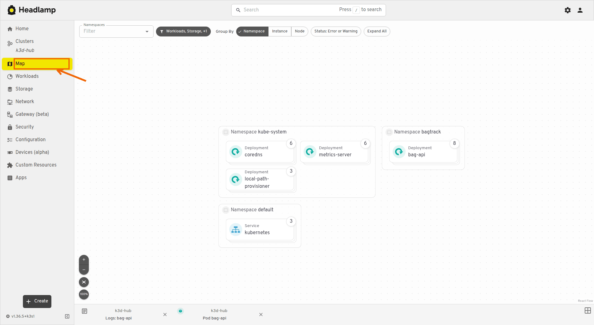

   <!-- shots:end -->

   <!-- ui: headlamp_view map -->

   The map shows the bag-api Deployment, its ReplicaSet and its three Pods.

## Part 2: Service discovery

1. Show the bag-api Service.

   ```bash
   kubectl -n bagtrack get service bag-api
   ```

   TYPE is `ClusterIP`, and CLUSTER-IP is the address of the Service.

2. Look up the DNS name of the Service from a temporary Pod (`--rm` deletes the Pod at the end).

   ```bash
   kubectl -n bagtrack run dns-test --rm -i --restart=Never \
     --image=public.ecr.aws/docker/library/busybox:1.37 -- nslookup bag-api.bagtrack.svc.cluster.local
   ```

   The `Address` line under `Name: bag-api.bagtrack.svc.cluster.local` shows the CLUSTER-IP from step 1.

3. Show the endpoints behind the Service.

   ```bash
   kubectl -n bagtrack get endpointslices -l kubernetes.io/service-name=bag-api
   ```

   ENDPOINTS lists the IP addresses of the three bag-api Pods.

   <!-- test
   t_eq "$(kubectl -n bagtrack get endpointslices -l kubernetes.io/service-name=bag-api -o json \
     | jq '[.items[].endpoints[]? | select(.conditions.ready)] | length')" 3 "ready bag-api endpoints"
   -->

## Part 3: The board and the scanner

1. Create `~/bagtrack/k8s/board.yaml` in VS Code with this content and save it.

   <!-- file: ~/bagtrack/k8s/board.yaml -->
   ```yaml
   apiVersion: apps/v1
   kind: Deployment
   metadata:
     name: board
     namespace: bagtrack
   spec:
     replicas: 2
     selector:
       matchLabels:
         app: board
     template:
       metadata:
         labels:
           app: board
       spec:
         containers:
         - name: board
           image: localhost:5000/board:1.0
           ports:
           - containerPort: 8080
           env:
           - name: BAG_API_URL
             value: http://bag-api:8000
           readinessProbe:
             httpGet: {path: /healthz, port: 8080}
   ---
   apiVersion: v1
   kind: Service
   metadata:
     name: board
     namespace: bagtrack
   spec:
     type: LoadBalancer
     selector:
       app: board
     ports:
     - port: 80
       targetPort: 8080
   ---
   apiVersion: v1
   kind: Service
   metadata:
     name: board-nodeport
     namespace: bagtrack
   spec:
     type: NodePort
     selector:
       app: board
     ports:
     - port: 80
       targetPort: 8080
       nodePort: 30080
   ```

2. Create `~/bagtrack/k8s/scanner.yaml` in VS Code with this content and save it.

   <!-- file: ~/bagtrack/k8s/scanner.yaml -->
   ```yaml
   apiVersion: apps/v1
   kind: Deployment
   metadata:
     name: scanner
     namespace: bagtrack
   spec:
     replicas: 2
     selector:
       matchLabels:
         app: scanner
     template:
       metadata:
         labels:
           app: scanner
       spec:
         containers:
         - name: scanner
           image: localhost:5000/scanner:1.0
           env:
           - name: API_URL
             value: http://bag-api:8000
           livenessProbe:
             httpGet: {path: /healthz, port: 8081}
   ```

3. Apply both files.

   ```bash
   kubectl apply -f k8s/board.yaml -f k8s/scanner.yaml
   ```

   <!-- test
   t_rollout bagtrack board
   t_rollout bagtrack scanner
   t_get http://localhost:8081/healthz >/dev/null
   t_get http://localhost:30080/healthz >/dev/null
   -->

4. Show the Deployments.

   ```bash
   kubectl -n bagtrack get deploy
   ```

   `bag-api` shows `3/3`, and `board` and `scanner` show `2/2` (run the command again if a number is lower).

5. Show the Services.

   ```bash
   kubectl -n bagtrack get services
   ```

   `board` has the TYPE `LoadBalancer`, and `board-nodeport` shows the ports `80:30080/TCP`.

6. Open http://localhost:8081 in the browser and watch the footer of the board.

   <!-- shots:begin -->
   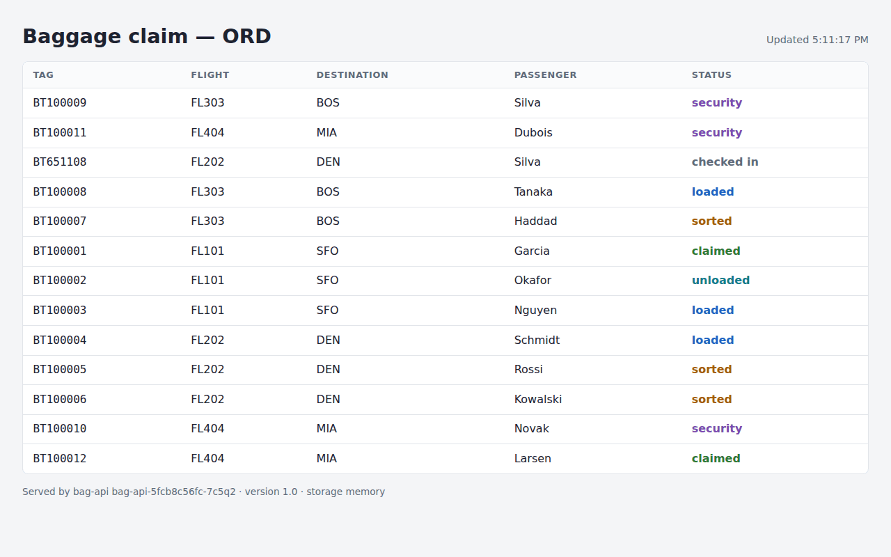

   <!-- shots:end -->

   <!-- ui: browser_open http://localhost:8081 -->

   The footer names a different bag-api Pod from one update to the next, and the bags change with it, because each Pod keeps its own bags in memory (Lab 09 fixes that).

7. Open http://localhost:30080 in a new browser tab.

   <!-- shots:begin -->
   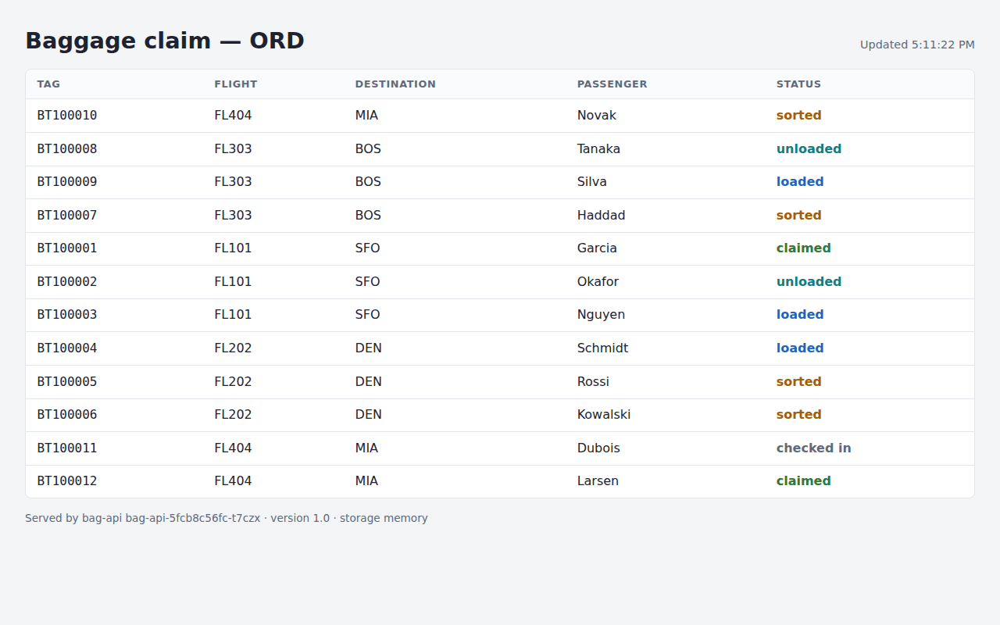

   <!-- shots:end -->

   <!-- ui: browser_open http://localhost:30080 -->

   The NodePort Service shows the same board.

8. Ask the board for `/api/info` six times (`--retry` repeats a request that fails while an old Pod shuts down).

   ```bash
   for i in 1 2 3 4 5 6; do curl -sf --retry 5 --retry-all-errors localhost:8081/api/info | jq -r .hostname; done
   ```

   The lines name more than one bag-api Pod.

   <!-- test
   n=$(for i in $(seq 1 12); do t_get http://localhost:8081/api/info | jq -r .hostname; done | sort -u | wc -l)
   [ "$n" -ge 2 ] || { echo "check failed: only $n bag-api Pod(s) answered behind the board" >&2; exit 1; }
   -->

## Part 4: Scale and self-heal

1. Scale bag-api to five replicas.

   ```bash
   kubectl -n bagtrack scale deploy/bag-api --replicas=5
   ```

   The output is `deployment.apps/bag-api scaled`.

   <!-- test
   t_rollout bagtrack bag-api
   -->

2. List the bag-api Pods.

   ```bash
   kubectl -n bagtrack get pods -l app=bag-api
   ```

   Five Pods are listed (run the command again until all five show `Running`).

3. In Headlamp, click **Workloads**, then **Deployments**, then **bag-api**, then the **Scale** icon, set **Desired number of replicas** to `3`, and click **Apply**.

   <!-- shots:begin -->
   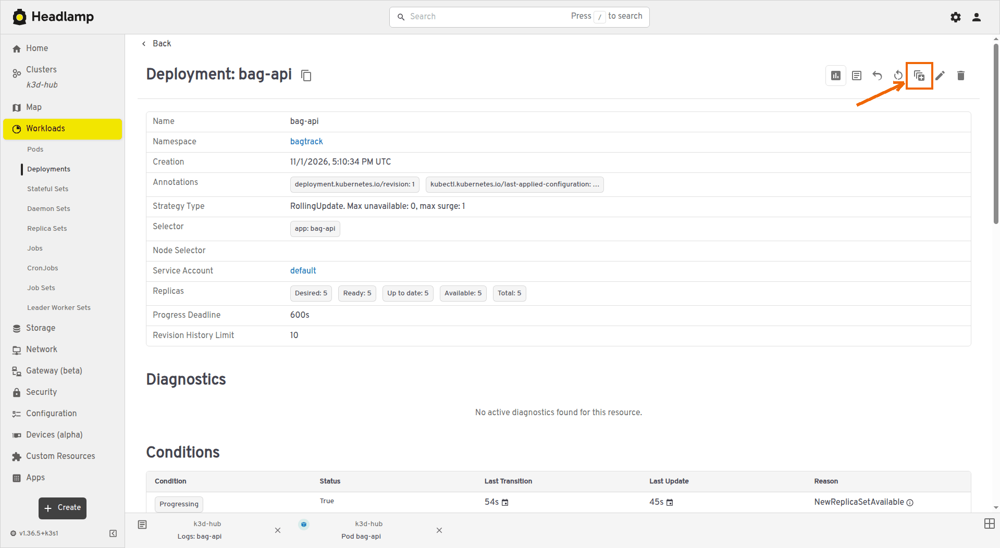

   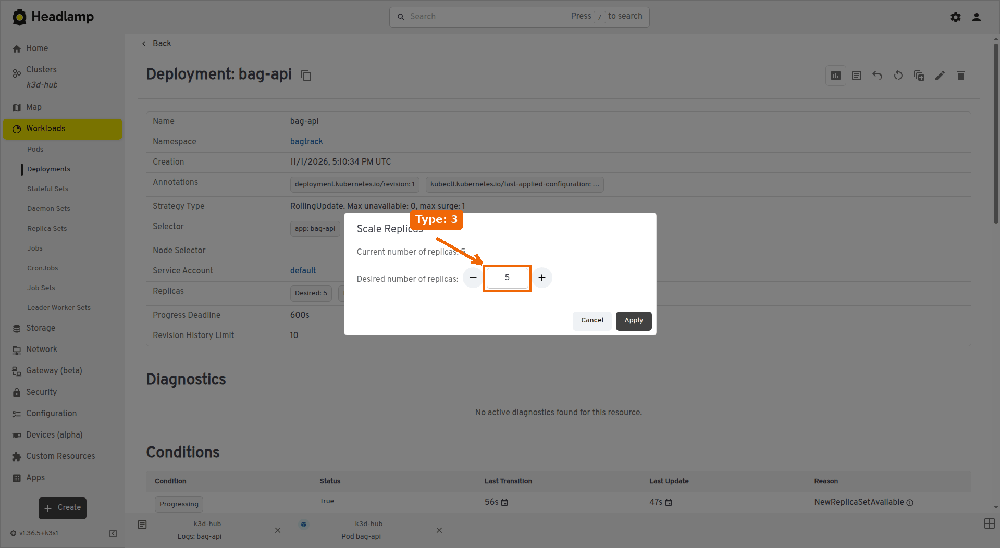

   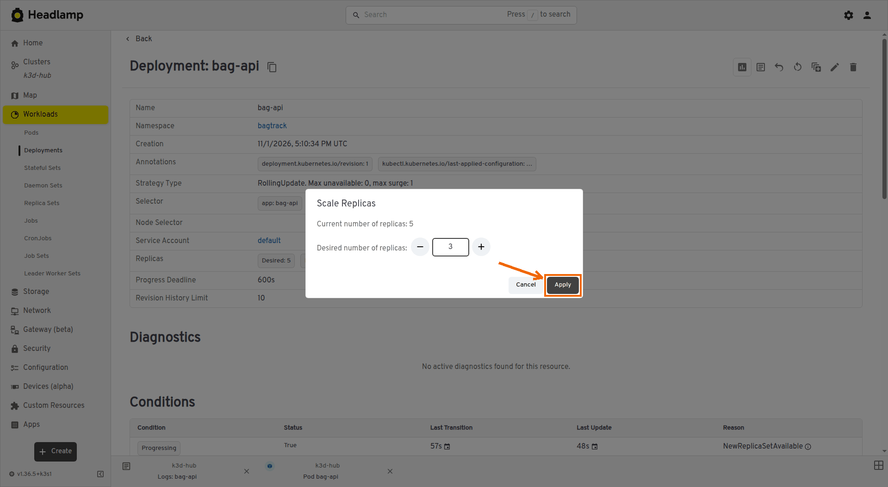

   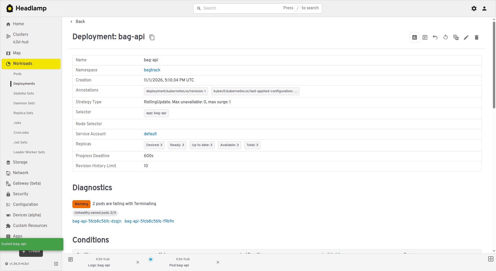

   <!-- shots:end -->

   <!-- ui: headlamp_scale bagtrack bag-api 3 -->

   Until the two extra Pods have stopped, **Diagnostics** shows the warning `2 pods are failing with Terminating`.

   <!-- test
   for i in $(seq 1 60); do
     [ "$(kubectl -n bagtrack get pods -l app=bag-api --no-headers | wc -l)" -eq 3 ] && break
     sleep 2
   done
   t_rollout bagtrack bag-api
   -->

4. Show the Deployment.

   ```bash
   kubectl -n bagtrack get deploy bag-api
   ```

   READY is `3/3`.

   <!-- test
   t_eq "$(kubectl -n bagtrack get deploy bag-api -o jsonpath='{.spec.replicas}')" 3 "bag-api replicas"
   -->

5. In Headlamp, click **Workloads**, then **Pods**, then one of the **bag-api-…** Pods, then the **More delete options** arrow to the right of the bin icon, then **Delete**, and confirm with **Delete**.

   <!-- shots:begin -->
   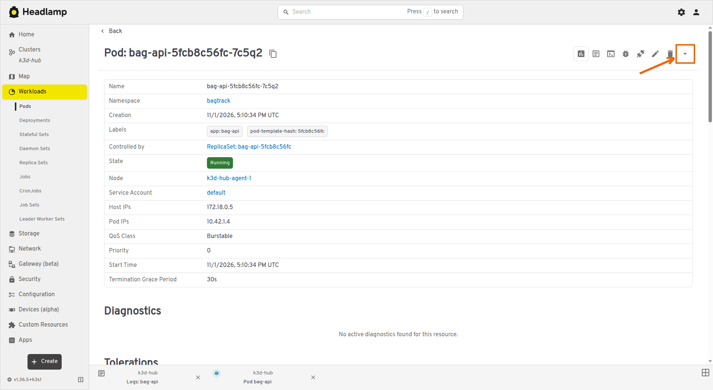

   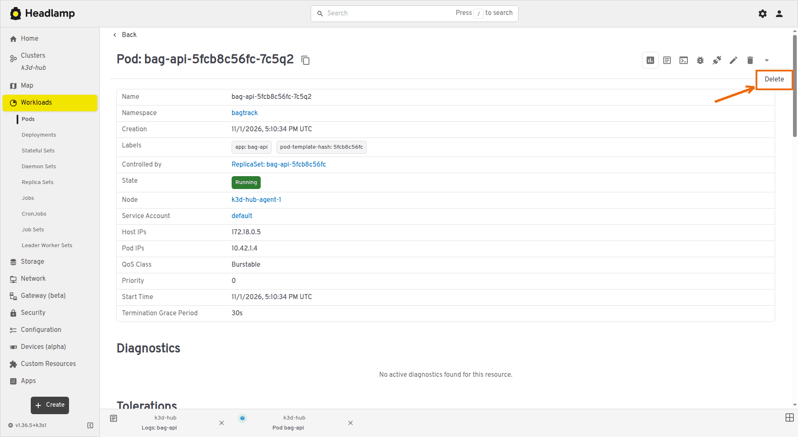

   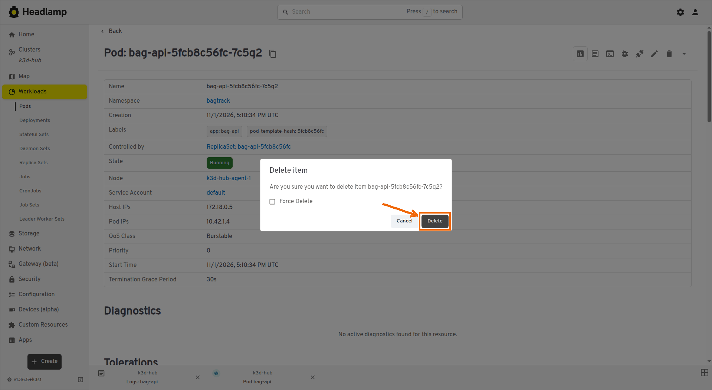

   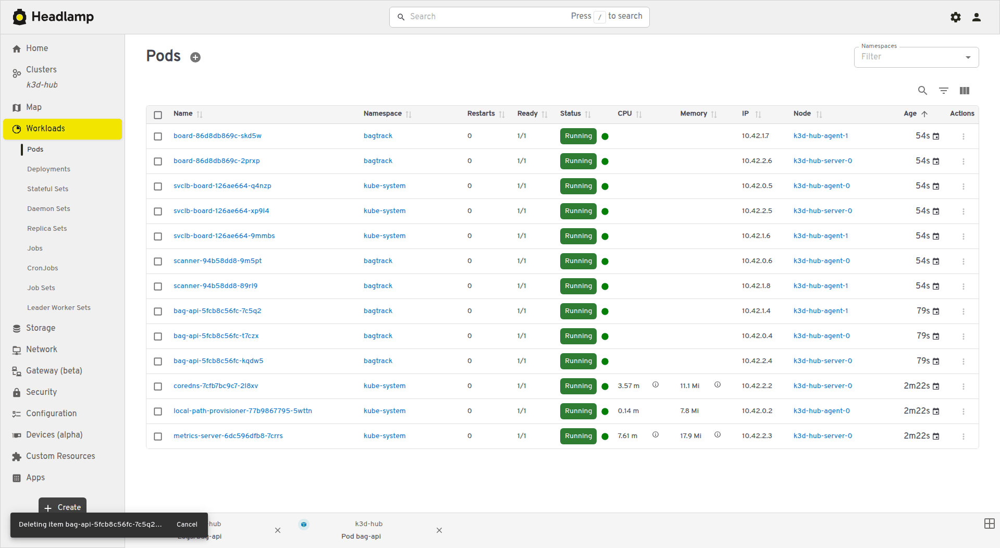

   <!-- shots:end -->

   <!-- ui: headlamp_delete_pod bagtrack bag-api -->

   Headlamp shows `Deleting item` with a **Cancel** button for a few seconds before it deletes the Pod. If you click the bin icon itself, Headlamp offers **Evict** instead of **Delete**, which also works for this step.

6. List the bag-api Pods again.

   ```bash
   kubectl -n bagtrack get pods -l app=bag-api
   ```

   The ReplicaSet has started a new Pod, with a small AGE, in place of the one you deleted.

   <!-- test
   for i in $(seq 1 60); do
     pods=$(kubectl -n bagtrack get pods -l app=bag-api --no-headers || true)
     [ "$(grep -c ' Running ' <<<"$pods")" -eq 3 ] && [ "$(wc -l <<<"$pods")" -eq 3 ] && break
     sleep 2
   done
   t_rollout bagtrack bag-api
   -->

## Part 5: Rolling update to the pipeline's image

1. Find the newest tag that the Harness pipeline published.

   ```bash
   TAG=$(curl -s localhost:5000/v2/bag-api/tags/list | jq -r '.tags[]' | grep '^1\.0\.' | sort -V | tail -1)
   echo $TAG
   ```

   The output is a tag such as `1.0.2`.

   <!-- test
   [ -n "$TAG" ] || { echo "check failed: the registry has no 1.0.<n> tag of bag-api" >&2; exit 1; }
   t_tag_in_registry bag-api "$TAG"
   -->

2. Change the image of bag-api to that tag.

   ```bash
   kubectl -n bagtrack set image deploy/bag-api bag-api=localhost:5000/bag-api:$TAG
   ```

   The output is `deployment.apps/bag-api image updated`.

3. Follow the rolling update until it finishes.

   ```bash
   kubectl -n bagtrack rollout status deploy/bag-api --timeout=180s
   ```

   The last line is `deployment "bag-api" successfully rolled out`.

4. Look at the footer of the board in the browser.

   <!-- shots:begin -->
   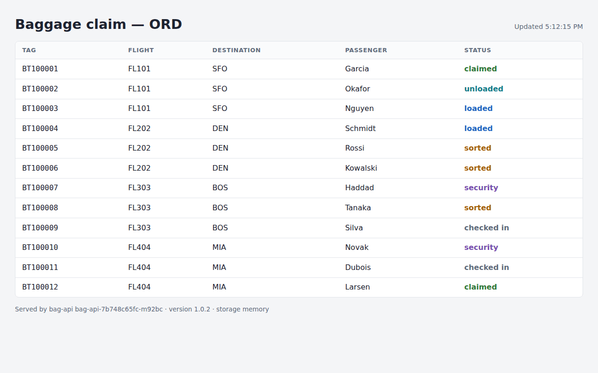

   <!-- shots:end -->

   <!-- ui: browser_open http://localhost:8081 -->

   The footer shows the version from step 1, such as `version 1.0.2`.

   <!-- test
   for i in $(seq 1 15); do
     v=$(curl -fsS localhost:8081/api/info | jq -r .version) || true
     [ "$v" = "$TAG" ] && break
     sleep 2
   done
   t_eq "$v" "$TAG" "bag-api version behind the board"
   -->

5. Show the rollout history.

   ```bash
   kubectl -n bagtrack rollout history deploy/bag-api
   ```

   Revision 2 is the update from step 2.

## Part 6: A failed rollout and a rollback

1. Change the image to a tag that does not exist.

   ```bash
   kubectl -n bagtrack set image deploy/bag-api bag-api=localhost:5000/bag-api:9.9
   ```

2. Follow the rollout.

   <!-- expect-fail -->

   ```bash
   kubectl -n bagtrack rollout status deploy/bag-api --timeout=60s
   ```

   It stops at the timeout with `error: timed out waiting for the condition`.

3. List the bag-api Pods.

   ```bash
   kubectl -n bagtrack get pods -l app=bag-api
   ```

   One new Pod shows `ErrImagePull` or `ImagePullBackOff`, and the three Pods of the previous version keep running.

   <!-- test
   kubectl -n bagtrack get pods -l app=bag-api --no-headers | grep -E 'ErrImagePull|ImagePullBackOff'
   t_eq "$(kubectl -n bagtrack get deploy bag-api -o jsonpath='{.status.availableReplicas}')" 3 "available bag-api replicas"
   -->

4. Roll back to the previous revision.

   ```bash
   kubectl -n bagtrack rollout undo deploy/bag-api
   ```

   The last line is `deployment.apps/bag-api rolled back`.

5. Follow the rollback until it finishes.

   ```bash
   kubectl -n bagtrack rollout status deploy/bag-api --timeout=120s
   ```

6. Show the Deployment with its image.

   ```bash
   kubectl -n bagtrack get deploy bag-api -o wide
   ```

   READY is `3/3`, and IMAGES shows the tag from Part 5.

   <!-- test
   t_eq "$(kubectl -n bagtrack get deploy bag-api -o jsonpath='{.spec.template.spec.containers[0].image}')" \
     "localhost:5000/bag-api:$TAG" "bag-api image after the rollback"
   -->

## Check your work

1. List the Deployments and the Services.

   ```bash
   kubectl -n bagtrack get deploy,services
   ```

   `bag-api` shows `3/3`, `board` and `scanner` show `2/2`, `board` is a `LoadBalancer`, and `board-nodeport` uses port `30080`.

2. Ask the board which bag-api answers.

   ```bash
   curl -sf --retry 5 --retry-all-errors localhost:8081/api/info | jq
   ```

   `version` is the tag from Part 5, and `storage` is `memory`.

   <!-- test
   for d in bag-api board scanner; do t_rollout bagtrack "$d"; done
   t_eq "$(kubectl -n bagtrack get deploy bag-api -o jsonpath='{.spec.replicas}')" 3 "bag-api replicas"
   t_eq "$(kubectl -n bagtrack get deploy board -o jsonpath='{.spec.replicas}')" 2 "board replicas"
   t_eq "$(kubectl -n bagtrack get deploy scanner -o jsonpath='{.spec.replicas}')" 2 "scanner replicas"
   kubectl -n bagtrack get deploy bag-api -o jsonpath='{.spec.template.spec.containers[0].image}' \
     | grep -E '^localhost:5000/bag-api:1\.0\.[0-9]+$'
   t_eq "$(kubectl -n bagtrack get service bag-api -o jsonpath='{.spec.type}')" ClusterIP "bag-api Service type"
   t_eq "$(kubectl -n bagtrack get service board -o jsonpath='{.spec.type}')" LoadBalancer "board Service type"
   t_eq "$(kubectl -n bagtrack get service board-nodeport -o jsonpath='{.spec.ports[0].nodePort}')" 30080 "board NodePort"
   t_get http://localhost:8081/api/info | jq -e '.storage == "memory"' >/dev/null
   -->

<!-- runner: stop -->

## Troubleshooting

| Problem | Fix |
|---|---|
| http://localhost:8081 does not load, or `curl -s localhost:8081/api/info` prints nothing | The board is not ready yet. Run `kubectl -n bagtrack rollout status deploy/board --timeout=120s` and try again. |
| The board shows the red banner `API unreachable` | No bag-api Pod is ready. Run `kubectl -n bagtrack get pods -l app=bag-api` and look at the Pods that are not `1/1`. |
| `board` Pods show `CrashLoopBackOff`, and `kubectl -n bagtrack logs deploy/board` shows `host not found in upstream` | The board started before the `bag-api` Service existed. Apply `k8s/bag-api-deployment.yaml`, then run `kubectl -n bagtrack rollout restart deploy/board`. |
| `Error from server (AlreadyExists): pods "dns-test" already exists` | A test Pod from an earlier try is left. Run `kubectl -n bagtrack delete pod dns-test` and repeat the step. |
| `echo $TAG` prints an empty line | Run the `TAG=...` command again in this terminal. If it stays empty, the registry has no `1.0.` tag yet, and Lab 06 is not finished. |
| New bag-api Pods show `InvalidImageName` | `$TAG` was empty in the `set image` step. Set `TAG` again and repeat the step. |
| `rollout undo` prints `Warning: resource deployments/bag-api was previously managed with 'kubectl apply'` | The warning does not stop the rollback. The last line, `deployment.apps/bag-api rolled back`, shows that it worked. |
| http://localhost:30080 does not answer | The cluster has no port mapping for 30080. Run `k3d cluster edit hub --port-add "30080:30080@loadbalancer"`. |

## Going further (optional)

- Run `kubectl -n bagtrack annotate deploy/bag-api kubernetes.io/change-cause="pipeline image $TAG"`, then show the rollout history again.
- Run `kubectl -n bagtrack get pods -l app=bag-api -w` in a second terminal, then `kubectl -n bagtrack rollout restart deploy/bag-api`, and watch the Pods change one at a time.
- Find the Pods that k3s runs for the `board` LoadBalancer Service with `kubectl -n kube-system get pods -o wide | grep svclb`.
