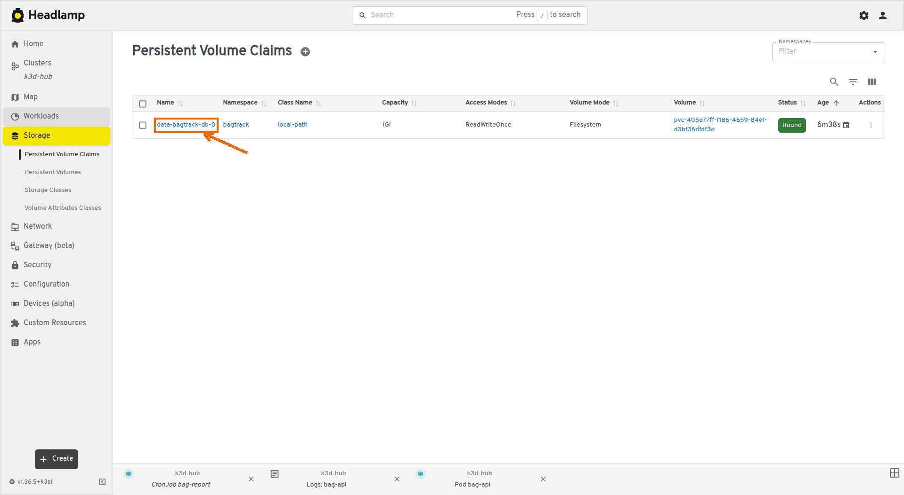
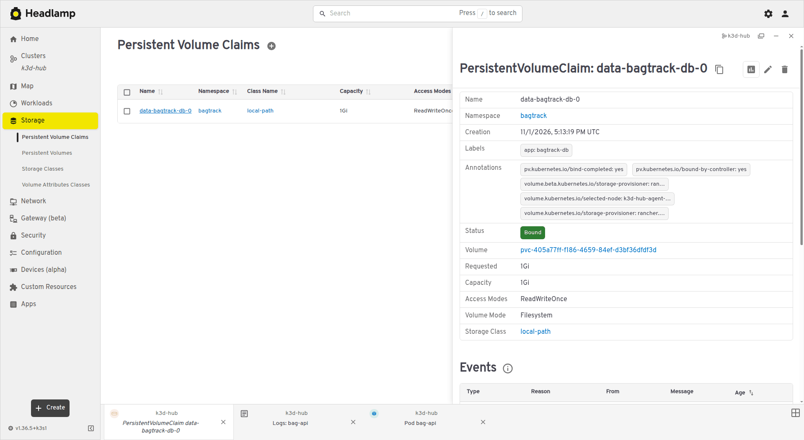
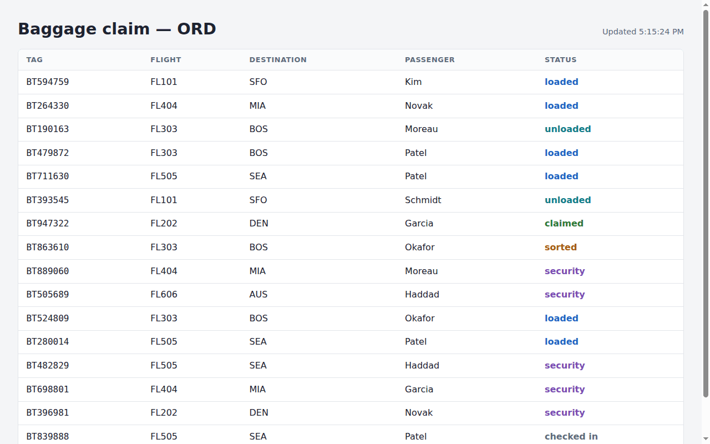
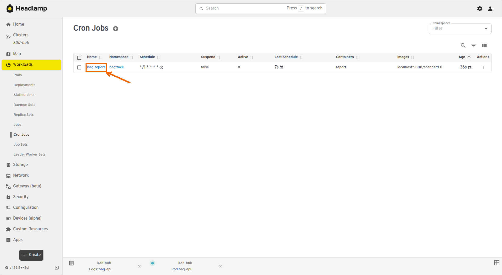
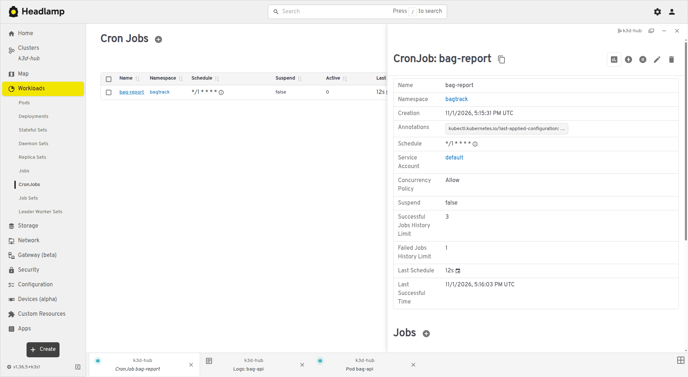

# Lab 09: Storage, StatefulSets and batch work

**Goal:** Move the BagTrack data into a Postgres StatefulSet with a persistent volume, then add a Job, a CronJob, a DaemonSet and a shared emptyDir volume.

**Lecture:** L13

**Start:** Lab 08 finished, or run `~/containerization-fundamentals/scripts/catch-up.sh 09` on a fresh VM.

## Part 1: Postgres as a StatefulSet

1. Go to your working folder.

   ```bash
   cd ~/bagtrack
   ```

2. Create a Secret with the database password.

   ```bash
   kubectl -n bagtrack create secret generic bagtrack-db --from-literal=password=bagtrack-k8s-pw
   ```

   The output is `secret/bagtrack-db created`.

3. Create `~/bagtrack/k8s/postgres.yaml` in VS Code with this content and save it.

   <!-- file: ~/bagtrack/k8s/postgres.yaml -->
   ```yaml
   apiVersion: v1
   kind: Service
   metadata:
     name: bagtrack-db
     namespace: bagtrack
   spec:
     clusterIP: None
     selector:
       app: bagtrack-db
     ports:
     - port: 5432
   ---
   apiVersion: apps/v1
   kind: StatefulSet
   metadata:
     name: bagtrack-db
     namespace: bagtrack
   spec:
     serviceName: bagtrack-db
     replicas: 1
     selector:
       matchLabels:
         app: bagtrack-db
     template:
       metadata:
         labels:
           app: bagtrack-db
       spec:
         containers:
         - name: postgres
           image: public.ecr.aws/docker/library/postgres:17
           env:
           - name: POSTGRES_USER
             value: bagtrack
           - name: POSTGRES_DB
             value: bagtrack
           - name: POSTGRES_PASSWORD
             valueFrom:
               secretKeyRef: {name: bagtrack-db, key: password}
           - name: PGDATA
             value: /var/lib/postgresql/data/pgdata
           ports:
           - containerPort: 5432
           readinessProbe:
             exec:
               command: ["pg_isready", "-U", "bagtrack", "-d", "bagtrack"]
             periodSeconds: 5
           volumeMounts:
           - name: data
             mountPath: /var/lib/postgresql/data
     volumeClaimTemplates:
     - metadata:
         name: data
       spec:
         accessModes: ["ReadWriteOnce"]
         resources:
           requests:
             storage: 1Gi
   ```

4. Apply it.

   ```bash
   kubectl apply -f k8s/postgres.yaml
   ```

   The output lists `service/bagtrack-db created` and `statefulset.apps/bagtrack-db created`.

5. Wait until the database Pod is ready.

   ```bash
   kubectl -n bagtrack rollout status statefulset/bagtrack-db --timeout=180s
   ```

   The last line is `partitioned roll out complete: 1 new pods have been updated...`.

6. Show the database Pod and its Service.

   ```bash
   kubectl -n bagtrack get pod/bagtrack-db-0 service/bagtrack-db
   ```

   The Pod has the fixed name `bagtrack-db-0`, and the CLUSTER-IP of the Service is `None`.

7. Show the volume claim and the volume.

   ```bash
   kubectl -n bagtrack get pvc,pv
   ```

   The claim `data-bagtrack-db-0` is `Bound` to a volume of the storage class `local-path`.

   <!-- test
   t_eq "$(kubectl -n bagtrack get pvc data-bagtrack-db-0 -o jsonpath='{.status.phase}')" Bound "database volume claim"
   -->

8. In Headlamp, click **Storage**, then **Persistent Volume Claims**, then **data-bagtrack-db-0**.

   <!-- shots:begin -->
   

   

   <!-- shots:end -->

   <!-- ui: headlamp_view pvcs bagtrack data-bagtrack-db-0 -->

## Part 2: bag-api uses the database

1. Set `SEED` to `"false"` in `~/bagtrack/k8s/bag-api-config.yaml` in VS Code, so that the file has this content, and save it.

   <!-- file: ~/bagtrack/k8s/bag-api-config.yaml -->
   ```yaml
   apiVersion: v1
   kind: ConfigMap
   metadata:
     name: bag-api-config
     namespace: bagtrack
   data:
     HUB: ORD
     SEED: "false"
   ```

   bag-api then starts without adding the sample bags, and the Job in Part 3 adds them.

2. Replace the content of `~/bagtrack/k8s/bag-api-deployment.yaml` in VS Code with this and save it.

   <!-- file: ~/bagtrack/k8s/bag-api-deployment.yaml -->
   ```yaml
   apiVersion: apps/v1
   kind: Deployment
   metadata:
     name: bag-api
     namespace: bagtrack
   spec:
     replicas: 3
     selector:
       matchLabels:
         app: bag-api
     strategy:
       type: RollingUpdate
       rollingUpdate: {maxSurge: 1, maxUnavailable: 0}
     template:
       metadata:
         labels:
           app: bag-api
       spec:
         initContainers:
         - name: wait-for-db
           image: public.ecr.aws/docker/library/busybox:1.37
           command: ["sh", "-c", "until nc -z bagtrack-db 5432; do echo waiting for bagtrack-db; sleep 2; done"]
         containers:
         - name: bag-api
           image: localhost:5000/bag-api:1.0
           ports:
           - containerPort: 8000
           envFrom:
           - configMapRef:
               name: bag-api-config
           - secretRef:
               name: bag-api-db
           livenessProbe:
             httpGet: {path: /healthz, port: 8000}
             periodSeconds: 10
           readinessProbe:
             httpGet: {path: /readyz, port: 8000}
             periodSeconds: 5
           resources:
             requests: {cpu: 50m, memory: 64Mi}
             limits: {memory: 256Mi}
   ---
   apiVersion: v1
   kind: Service
   metadata:
     name: bag-api
     namespace: bagtrack
   spec:
     selector:
       app: bag-api
     ports:
     - port: 8000
       targetPort: 8000
   ```

   The new parts are the init container `wait-for-db` and the Secret `bag-api-db` under `envFrom`.

3. Save the image that bag-api runs now in the variable `IMAGE`.

   ```bash
   IMAGE=$(kubectl -n bagtrack get deploy bag-api -o jsonpath='{.spec.template.spec.containers[0].image}')
   echo $IMAGE
   ```

   The output is the pipeline image from Lab 08, such as `localhost:5000/bag-api:1.0.2`.

   <!-- test
   [ -n "$IMAGE" ] || { echo "check failed: IMAGE is empty" >&2; exit 1; }
   -->

4. Write that image into the file, and show the image lines.

   ```bash
   sed -i "s|image: localhost:5000/bag-api:.*|image: $IMAGE|" k8s/bag-api-deployment.yaml
   grep 'image:' k8s/bag-api-deployment.yaml
   ```

   The second line shows the image from step 3.

   <!-- test
   grep -qF "image: $IMAGE" k8s/bag-api-deployment.yaml
   -->

5. Apply both files.

   ```bash
   kubectl apply -f k8s/bag-api-config.yaml -f k8s/bag-api-deployment.yaml
   ```

   The output lists `configmap/bag-api-config configured`, `deployment.apps/bag-api configured` and `service/bag-api unchanged`.

   <!-- test
   t_eq "$(kubectl -n bagtrack get configmap bag-api-config -o jsonpath='{.data.SEED}')" false "SEED in bag-api-config"
   -->

6. Follow the rolling update until it finishes.

   ```bash
   kubectl -n bagtrack rollout status deploy/bag-api --timeout=180s
   ```

   The last line is `deployment "bag-api" successfully rolled out`.

   <!-- test
   t_eq "$(kubectl -n bagtrack get deploy bag-api -o jsonpath='{.spec.template.spec.containers[0].image}')" "$IMAGE" "bag-api image"
   -->

7. Ask the board for `/api/info` six times (`--retry` repeats a request that fails while an old Pod shuts down).

   ```bash
   for i in 1 2 3 4 5 6; do curl -sf --retry 5 --retry-all-errors localhost:8081/api/info | jq -r '.hostname + " " + .storage'; done
   ```

   Every line names a bag-api Pod and ends with `postgres`.

   <!-- test
   for i in $(seq 1 6); do
     t_eq "$(t_get http://localhost:8081/api/info | jq -r .storage)" postgres "storage behind the board"
   done
   -->

8. Look at the board in the browser.

   <!-- shots:begin -->
   

   <!-- shots:end -->

   <!-- ui: browser_open http://localhost:8081 -->

   The footer shows `storage postgres`, and the bags stay the same when the footer names another Pod.

## Part 3: A seed Job

1. Create `~/bagtrack/k8s/seed-job.yaml` in VS Code with this content and save it.

   <!-- file: ~/bagtrack/k8s/seed-job.yaml -->
   ```yaml
   apiVersion: batch/v1
   kind: Job
   metadata:
     name: seed
     namespace: bagtrack
   spec:
     backoffLimit: 3
     template:
       spec:
         restartPolicy: OnFailure
         containers:
         - name: seed
           image: localhost:5000/bag-api:1.0
           command: ["python", "-m", "bagtrack.seed"]
           env:
           - name: DATABASE_URL
             valueFrom:
               secretKeyRef: {name: bag-api-db, key: DATABASE_URL}
   ```

2. Apply it.

   ```bash
   kubectl apply -f k8s/seed-job.yaml
   ```

3. Wait until the Job is complete.

   ```bash
   kubectl -n bagtrack wait --for=condition=complete job/seed --timeout=120s
   ```

   The output is `job.batch/seed condition met`.

4. Show the log of the Job.

   ```bash
   kubectl -n bagtrack logs job/seed
   ```

   The output is `Added 12 of 12 sample bags.`

   <!-- test
   kubectl -n bagtrack logs job/seed | t_contains "Added 12 of 12 sample bags." "seed Job log"
   -->

## Part 4: Data survives the Pod

1. Check in a new bag through the board, and keep its tag in `BAG`.

   ```bash
   BAG=$(curl -s -X POST localhost:8081/api/bags -H 'Content-Type: application/json' \
     -d '{"flight":"FL101","passenger":"Rivera","destination":"SFO"}' | jq -r .tag)
   echo $BAG
   ```

   The output is a bag tag such as `BT482913`.

   <!-- test
   [[ "$BAG" =~ ^BT[0-9]{6}$ ]] || { echo "check failed: BAG is '$BAG'" >&2; exit 1; }
   t_get http://localhost:8081/api/stats | jq -r .total > "$STATE/lab09-bags-before"
   -->

2. Delete the database Pod.

   ```bash
   kubectl -n bagtrack delete pod bagtrack-db-0
   ```

   <!-- test
   for i in $(seq 1 90); do
     [ "$(kubectl -n bagtrack get pod bagtrack-db-0 -o jsonpath='{.status.containerStatuses[0].ready}' 2>/dev/null)" = true ] && break
     sleep 2
   done
   kubectl -n bagtrack wait --for=condition=Ready pod/bagtrack-db-0 --timeout=60s
   -->

3. Show the database Pod.

   ```bash
   kubectl -n bagtrack get pod bagtrack-db-0
   ```

   The new Pod has the same name, `bagtrack-db-0`, and a small AGE (run the command again until READY is `1/1`).

   <!-- test
   t_get "http://localhost:8081/api/bags/$BAG" | jq -e '.passenger == "Rivera"' >/dev/null
   before=$(cat "$STATE/lab09-bags-before")
   after=$(t_get http://localhost:8081/api/stats | jq -r .total)
   [ "$after" -ge "$before" ] || { echo "check failed: $before bags before the restart, $after after it" >&2; exit 1; }
   -->

4. Read the bag again.

   ```bash
   curl -sf --retry 5 --retry-all-errors localhost:8081/api/bags/$BAG | jq
   ```

   bag-api returns your bag with `"passenger": "Rivera"` (if you get an error, run the command again).

## Part 5: A CronJob report

1. Create `~/bagtrack/k8s/report-cronjob.yaml` in VS Code with this content and save it.

   <!-- file: ~/bagtrack/k8s/report-cronjob.yaml -->
   ```yaml
   apiVersion: batch/v1
   kind: CronJob
   metadata:
     name: bag-report
     namespace: bagtrack
   spec:
     schedule: "*/1 * * * *"
     successfulJobsHistoryLimit: 3
     jobTemplate:
       spec:
         template:
           spec:
             restartPolicy: Never
             containers:
             - name: report
               image: localhost:5000/scanner:1.0
               args: ["report"]
               env:
               - name: API_URL
                 value: http://bag-api:8000
   ```

2. Apply it.

   ```bash
   kubectl apply -f k8s/report-cronjob.yaml
   ```

3. Show the CronJob.

   ```bash
   kubectl -n bagtrack get cronjob bag-report
   ```

   SCHEDULE is `*/1 * * * *`, which starts one Job per minute.

4. List the Jobs.

   ```bash
   kubectl -n bagtrack get jobs
   ```

   Run the command again until a `bag-report-…` Job shows `1/1` under COMPLETIONS.

   <!-- test
   for i in $(seq 1 45); do
     kubectl -n bagtrack get jobs -o name | grep -q bag-report && break
     sleep 4
   done
   J=$(kubectl -n bagtrack get jobs -o name | grep bag-report | head -1)
   kubectl -n bagtrack wait --for=condition=complete "$J" --timeout=120s
   -->

5. Show the log of the first report Job.

   ```bash
   JOB=$(kubectl -n bagtrack get jobs -o name | grep bag-report | head -1)
   kubectl -n bagtrack logs $JOB
   ```

   The report lists the number of bags at each checkpoint and a `total` line.

   <!-- test
   kubectl -n bagtrack logs "$JOB" | t_contains "total" "report output"
   -->

6. In Headlamp, click **Workloads**, then **CronJobs**, then **bag-report**.

   <!-- shots:begin -->
   

   

   <!-- shots:end -->

   <!-- ui: headlamp_view cronjobs bagtrack bag-report -->

## Part 6: A DaemonSet

1. Create `~/bagtrack/k8s/node-agent.yaml` in VS Code with this content and save it.

   <!-- file: ~/bagtrack/k8s/node-agent.yaml -->
   ```yaml
   apiVersion: apps/v1
   kind: DaemonSet
   metadata:
     name: node-agent
     namespace: bagtrack
   spec:
     selector:
       matchLabels:
         app: node-agent
     template:
       metadata:
         labels:
           app: node-agent
       spec:
         containers:
         - name: agent
           image: public.ecr.aws/docker/library/busybox:1.37
           command: ["sh", "-c", "while true; do echo \"$(date -u +%H:%M:%S) node=$NODE_NAME pods-on-node=$(ls /host-pods | wc -l)\"; sleep 30; done"]
           env:
           - name: NODE_NAME
             valueFrom:
               fieldRef: {fieldPath: spec.nodeName}
           volumeMounts:
           - name: pods
             mountPath: /host-pods
             readOnly: true
         volumes:
         - name: pods
           hostPath:
             path: /var/log/pods
             type: Directory
   ```

2. Apply it.

   ```bash
   kubectl apply -f k8s/node-agent.yaml
   ```

   <!-- test
   kubectl -n bagtrack rollout status ds/node-agent --timeout=120s
   -->

3. Show the node-agent Pods and their nodes.

   ```bash
   kubectl -n bagtrack get pods -l app=node-agent -o wide
   ```

   The NODE column shows one node-agent Pod on each of the three nodes.

   <!-- test
   t_eq "$(kubectl -n bagtrack get pods -l app=node-agent -o jsonpath='{range .items[*]}{.spec.nodeName}{"\n"}{end}' | sort -u | wc -l)" 3 "nodes with a node-agent Pod"
   for i in $(seq 1 15); do
     [ "$(kubectl -n bagtrack logs -l app=node-agent --prefix | grep -c 'node=')" -ge 3 ] && break
     sleep 2
   done
   -->

4. Show the log lines of all node-agent Pods.

   ```bash
   kubectl -n bagtrack logs -l app=node-agent --prefix
   ```

   Each line names the node of its Pod and counts the Pod log folders on that node.

## Part 7: emptyDir between two containers

1. Create `~/bagtrack/k8s/shared-scratch.yaml` in VS Code with this content and save it.

   <!-- file: ~/bagtrack/k8s/shared-scratch.yaml -->
   ```yaml
   apiVersion: v1
   kind: Pod
   metadata:
     name: shared-scratch
     namespace: bagtrack
   spec:
     containers:
     - name: writer
       image: public.ecr.aws/docker/library/busybox:1.37
       command: ["sh", "-c", "while true; do echo \"$(date -u +%H:%M:%S) line from the writer\" >> /scratch/log; sleep 2; done"]
       volumeMounts:
       - name: scratch
         mountPath: /scratch
     - name: reader
       image: public.ecr.aws/docker/library/busybox:1.37
       command: ["sh", "-c", "touch /scratch/log && tail -f /scratch/log"]
       volumeMounts:
       - name: scratch
         mountPath: /scratch
     volumes:
     - name: scratch
       emptyDir: {}
   ```

2. Apply it.

   ```bash
   kubectl apply -f k8s/shared-scratch.yaml
   ```

3. Show the Pod.

   ```bash
   kubectl -n bagtrack get pod shared-scratch
   ```

   READY is `2/2` (run the command again if it is lower).

   <!-- test
   kubectl -n bagtrack wait --for=condition=Ready pod/shared-scratch --timeout=120s
   for i in $(seq 1 15); do
     [ "$(kubectl -n bagtrack logs shared-scratch -c reader | wc -l)" -ge 3 ] && break
     sleep 2
   done
   -->

4. Show the last lines of the log of the reader container.

   ```bash
   kubectl -n bagtrack logs shared-scratch -c reader --tail 3
   ```

   The reader prints the lines that the writer container adds to `/scratch/log`.

   <!-- test
   kubectl -n bagtrack logs shared-scratch -c reader --tail 3 | t_contains "line from the writer" "reader output"
   -->

5. Delete the Pod (`--now` stops its containers at once).

   ```bash
   kubectl -n bagtrack delete pod shared-scratch --now
   ```

## Check your work

1. List the workloads in the namespace.

   ```bash
   kubectl -n bagtrack get statefulset,deploy,daemonset,cronjob
   ```

   `bagtrack-db` shows `1/1`, `bag-api` shows `3/3`, `board` and `scanner` show `2/2`, `node-agent` shows three Pods, and `bag-report` shows its schedule.

2. Show the volume claim of the database.

   ```bash
   kubectl -n bagtrack get pvc
   ```

   `data-bagtrack-db-0` is `Bound`.

3. Ask the board which bag-api answers.

   ```bash
   curl -sf --retry 5 --retry-all-errors localhost:8081/api/info | jq
   ```

   `storage` is `postgres`.

   <!-- test
   kubectl -n bagtrack rollout status statefulset/bagtrack-db --timeout=120s
   for d in bag-api board scanner; do t_rollout bagtrack "$d"; done
   kubectl -n bagtrack rollout status ds/node-agent --timeout=120s
   kubectl -n bagtrack get cronjob bag-report >/dev/null
   t_eq "$(kubectl -n bagtrack get job seed -o jsonpath='{.status.succeeded}')" 1 "seed Job"
   t_eq "$(kubectl -n bagtrack get configmap bag-api-config -o jsonpath='{.data.SEED}')" false "SEED in bag-api-config"
   t_eq "$(kubectl -n bagtrack get pvc data-bagtrack-db-0 -o jsonpath='{.status.phase}')" Bound "database volume claim"
   t_get http://localhost:8081/api/info | jq -e '.storage == "postgres"' >/dev/null
   if kubectl -n bagtrack get pod shared-scratch >/dev/null 2>&1; then echo "check failed: shared-scratch still exists" >&2; exit 1; fi
   -->

<!-- runner: stop -->

## Troubleshooting

| Problem | Fix |
|---|---|
| `bagtrack-db-0` stays `Pending` | Run `kubectl -n bagtrack describe pod bagtrack-db-0` and read the `Events`. Check that `local-path-provisioner` shows `Running` in `kubectl -n kube-system get pods`. |
| bag-api Pods stay at `Init:0/1` | The init container waits for `bagtrack-db`. Check that `kubectl -n bagtrack get statefulset,service bagtrack-db` lists both. |
| The rolling update in Part 2 times out, and a new bag-api Pod stays `0/1` | The Secrets `bag-api-db` and `bagtrack-db` may hold different passwords. Decode both as in Lab 07, Part 5, step 3. Postgres keeps the password of its first start, so fix the Secret, run `kubectl delete -f k8s/postgres.yaml` and `kubectl -n bagtrack delete pvc data-bagtrack-db-0`, and repeat Part 1 from step 4. |
| The board footer shows `version 1.0` after Part 2 | The `sed` step did not change the file. Run `kubectl -n bagtrack rollout undo deploy/bag-api`, then repeat Part 2 from step 3. |
| `error: timed out waiting for the condition on jobs/seed`, and `kubectl -n bagtrack logs job/seed` says `Cannot reach the database` | Check that `bagtrack-db-0` is ready with `kubectl -n bagtrack get pod bagtrack-db-0`, then run the `wait` step again. |
| `curl` in Part 4 prints a `jq` error or `Database unavailable` | The database or bag-api is not ready again yet. Run the command again. |
| `kubectl -n bagtrack get jobs` shows no `bag-report` Job | The CronJob starts its first Job at the next full minute. Run the command again. |

## Going further (optional)

- Count the bags in Postgres with `kubectl -n bagtrack exec bagtrack-db-0 -- psql -U bagtrack -d bagtrack -c 'select count(*) from bags'`.
- Start a report at once with `kubectl -n bagtrack create job report-now --from=cronjob/bag-report`, then read its log.
- Delete one node-agent Pod and check that the DaemonSet starts a new one on the same node.
